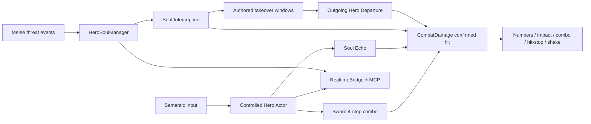

# SOUL OF HERO architecture

## Product boundary

The current production slice is a top-down training game with one approved Hero:
Sword. It is not a completed 20-level campaign. Axe/Bow/WeaponManager code is a
legacy migration dependency only; save, input, HUD, tutorial, roster and MCP state
use Hero/Soul contracts.

## Runtime flow



## Modules

### Hero data

`game/heroes/hero_definition.gd` is immutable content data. Sword's resource at
`game/heroes/data/sword_hero.tres` owns combo names/multipliers/timings/animation
IDs, wave/recoil movement, Soul Echo ratios/delays/targeting/visual references,
readiness, Summon timeline/takeover windows, unused-support cooldown and Departure.

Runtime state never mutates this resource.

### HeroSoulManager

`game/heroes/hero_soul_manager.gd` owns Active Hero + Reserve Soul lifecycle:

```text
IDLE -> READY -> SUMMONING -> IDLE (Relay)
                         \-> SUPPORT_COOLDOWN (unused completed support)
```

Readiness expiry goes directly to IDLE. Threat receipts are unique per attack
instance. The manager is generic; Hero behavior belongs to Summon/Departure
components.

Production team: active `sword_hero`, reserves empty. Debug team: active transient
Dummy, Sword reserve. Reserve capacity is two in save architecture, but only slot
one is currently visible and slot two has no input binding.

### Sword combat

The current controlled actor remains `KnightController` during the safe migration
phase. Production attack input bypasses WeaponManager and drives four explicit
actions with dedicated `sword_combo_1..4` strips. The old manager stays unreachable
from release input/UI and is scheduled for physical move to `game/legacy/` after
remaining scene/test references are removed.

Combo 3 spawns `sword_crescent_wave.tscn`; first confirmed wave target becomes the
Combo 4 pursuit target. Combo 2/4 temporarily ignore enemy-body collision while
world collision remains authoritative. Movement never grants implicit iframe.

### Soul Echo

`sword_soul_echo.tscn` is a world effect with no player ownership. It snapshots
each committed original attack and executes a reduced-damage mirror after data
delay. It owns separate safe-position correction, query hitboxes, cyan visuals,
trail and wave. It never edits the normal combo step or creates marks/iframe.

### Damage and feedback

`CombatDamage.apply_confirmed()` is the canonical accepted-hit gateway. It emits
actual health delta and presentation context. `game/feedback/combat_feedback.tscn`
subscribes once and owns pixel numbers, local impact, overlay, HIT counter,
bounded hit-stop and Camera2D offset shake. Accessibility settings gate numbers,
flashes and motion. Audio routing remains available, but runtime playback is
temporarily disabled at both scene routers and the muted Master bus.

### Enemies and threats

- Skeleton Swordsman emits one threat receipt on each melee wind-up.
- Blood Vampire emits one receipt per lunge telegraph.
- Reaper is ranged and does not generate Sword melee readiness.

Receiving damage is not a readiness requirement. Enemy AI, collision, stagger and
animation remain reusable from the prior vertical slice.

### Save v2

`SaveService` uses `unlocked_heroes`, `soul_team` and schema version 2. Migration
archives obsolete ownership/loadout under `legacy_audit`, maps only Sword to
`sword_hero`, and preserves unrelated progress/settings/receipts. Atomic temp,
rotating backup and permanent pre-v2 backup protect recovery.

### UI and tutorial

AppRoot routes Boot -> Title -> Home/Hub -> Level Details -> Gameplay. Sau khi
objective hoàn tất, `AppFlow.complete_active_run()` commit reward rồi phát
`run_completion_ready`; HUD hiện continuation chooser ngay trên gameplay cho
Next/Replay/Level Picker/Home, không route qua Results. Field Codex là scene
BookLite không pause với đúng hai section: inventory + sáu equipment slot (ba
Hero Soul, ba auxiliary) và stat + skill upgrade. Mọi mutation đi qua SaveService
trước khi Knight refresh projection. Production tutorial teaches Movement, Dash,
Combo 1-4 and Soul Echo.

### Realtime

Realtime snapshot exposes `hero`, `soul_relay`, player/session/level state and
fixed animation/frame data. MCP actions use canonical `soul_relay_1`; old Spirit
names are accepted solely as compatibility aliases without physical bindings.

## Legacy boundary

The following are excluded from production authority but retained until all old
tests/references are archived:

- `game/weapons/**`;
- Axe character-form implementation/assets;
- Bow reward scene/effects;
- Living Arsenal/Axe regression runners.

They must not appear in save defaults, roster, HUD, tutorial, production map,
release input or canonical realtime state.

## Extension rules

1. A new Hero requires a valid `HeroDefinition`, actor/presentation, four-or-other
   declared normal steps, approved Active Skill, readiness detector contract,
   Summon component, Departure component, feedback profile and tests.
2. Never infer Summon/Departure ownership from current body: incoming owns Summon,
   outgoing owns Departure.
3. All movement endpoints require physics-safe correction; the map has no required
   NavigationRegion2D.
4. Frequent effects must have bounded cleanup and stable attack instance IDs.
5. Debug-only definitions cannot be production-ready, persisted or listed.
