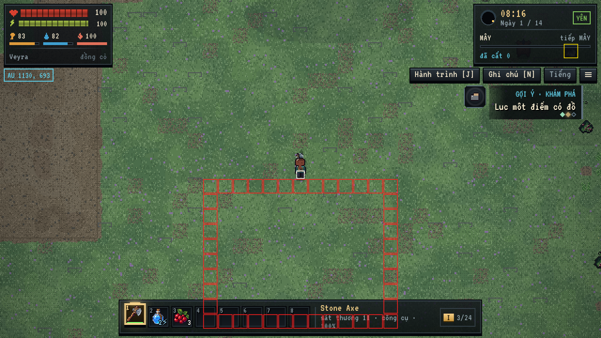
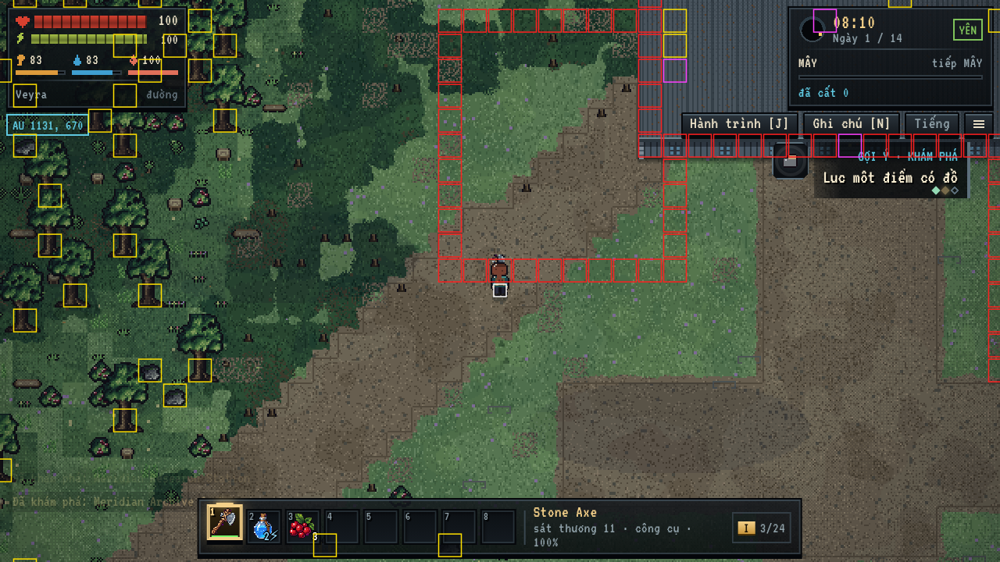
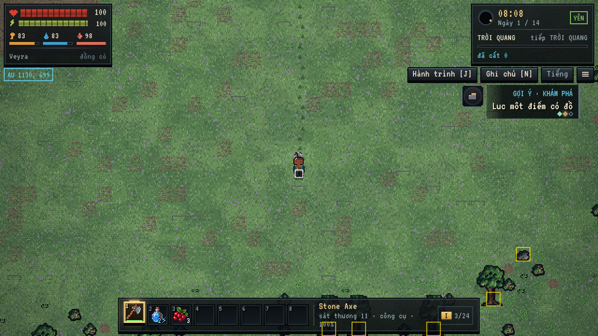
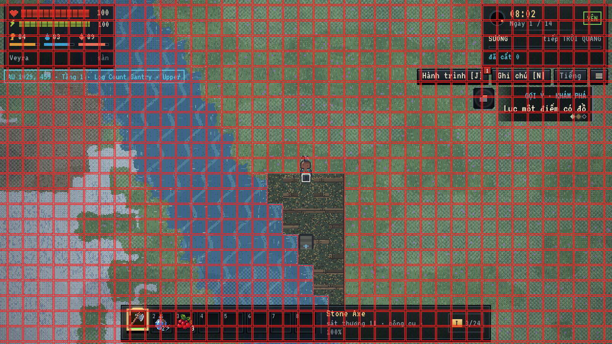
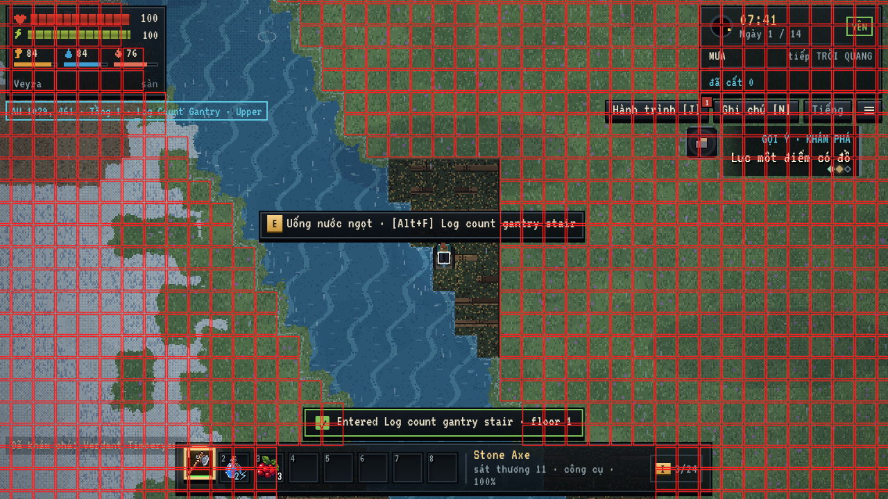

# Kiểm tra va chạm vô hình (bản web)

Phạm vi: game web trong `web/`, thế giới Veyra. Câu hỏi: chỗ nào người chơi bị chặn mà trên màn hình không có gì.

## Cách kiểm tra

1. Đọc luật di chuyển: `moveBody` (`sim.ts`) hỏi `solidFor` (`core-sites.ts`), `solidFor` đọc lưới va chạm `blockGrid` (`engine.ts`). Mỗi ô 16 px thuộc một loại: trống, tường địa hình, nguồn tài nguyên, công trình, nước lội được, dung nham, thang.
2. Quét dữ liệu cả 81 địa điểm: với mỗi ô bị chặn, tìm lý do nhìn thấy được (ô tường, vách đá, nước sâu, cây hoặc đá, đồ đạc có hình vẽ, rương). Ô nào bị chặn mà không có lý do thì ghi lại.
3. Dựng bản QA, chạy trong Chromium không màn hình, vẽ lưới va chạm đè lên ảnh chụp, rồi cho nhân vật đi thật vào chỗ nghi ngờ.

## Lỗi chính: tường của những ngôi nhà không bao giờ được vẽ

Ở 67 trên 81 địa điểm có những ô đất trông trống hoàn toàn nhưng không đi qua được. Tổng cộng 2.755 ô, trong đó 141 ô nằm ngay trên đường. Chúng xếp thành các khung chữ nhật kín khoảng 13 × 10 ô: người chơi không vào được bên trong, và đi ngang qua bãi cỏ thì đụng "tường".

Nguyên nhân: mỗi cửa sổ bản đồ có các mặt nạ kinh tế (`walkable`, `cargoPassable`, `slope`). Các mặt nạ này được biên dịch theo bố cục "kit" tự sinh của từng địa điểm (`window.ts`, `paddedPoiTiles`). Nhưng cả 81 địa điểm nay đều là bản dựng tay (`AUTHORED_SITES`), nên nhà kit không còn được vẽ (`slicePoisForWindow` bỏ qua chúng). Vòng tường của nhà kit vẫn nằm lại trong mặt nạ, và `cellClass` biến mọi ô có `walkable = 0` thành tường.

Những thứ cùng bị chặn theo, vì đều đọc chung lưới này: quái, xe kéo, xe máy, tên bắn, tầm nhìn của quái.

### Cách sửa

Không sửa thẳng mặt nạ được: `mapDigest` băm cả `walkable` lẫn `cargoPassable`, và `persist.ts` từ chối bản lưu có digest khác. Sửa mặt nạ nghĩa là mọi bản lưu đang đứng gần một địa điểm sẽ không mở lại được.

Thay vào đó, luật di chuyển hỏi một hàm mới, `veyraOpenGround` (`engine.ts`): ở tầng trệt của Veyra, ô hiển thị trên màn hình quyết định, không phải mặt nạ. Ô là đất trống (không phải nước sâu, vách đá, tường, dung nham, nước lội) thì mặt nạ không được chặn. Ba chỗ dùng hàm này:

| Ai | Chỗ sửa |
|---|---|
| Người chơi, quái, tên, tầm nhìn | `cellClass` trong `engine.ts` |
| Xe kéo | `solidFor` trong `core-sites.ts` |
| Xe máy (kể cả độ dốc = 1 của tường kit) | `vehicleCell` trong `motorbike.ts` |

Tường thật, vách đá, nước sâu giữ nguyên. Digest bản đồ không đổi nên bản lưu cũ vẫn mở được.

Phần thế giới nằm ngoài màn hình được mô phỏng bằng một hàm đọc riêng, `globalCellTileAndClass` (`engine.ts`). Hàm này nhận cùng hai luật (`globalOpenGround`), để cư dân và quái ở xa đi theo đúng bản đồ mà người chơi sẽ thấy khi tới nơi. Nếu không, một cư dân đã bước vào chỗ từng là khung kín sẽ bị nhốt lại ngay khi người chơi đi xa.

## Lỗi phụ tìm thấy khi quét: bước từ sàn tầng trên xuống sông

Ở tầng trên và tầng hầm, mọi ô ngoài sàn đều không đứng được, trừ một trường hợp: ô sông hoặc nước nông bên dưới. Loại "nước lội được" thắng mặt nạ, nên từ sàn gỗ ở Verdant Timberyard có thể bước ra sông và đi dọc sông trong khi vẫn ở "tầng 1". Đã sửa trong `cellClass`: ngoài tầng trệt, ô nước không thuộc sàn cũng là tường.

## Những thứ đã kiểm và không có lỗi

- Cây, đá, mỏ: ô chặn trùng với gốc hình vẽ. Nguồn đã khai thác hết thì không chặn.
- Đồ đạc và mốc kiến trúc (5.533 ô): ô nào chặn cũng có hình vẽ, không có vật nào chặn mà thiếu hình.
- Rương, tiền, máy bán, máy phát: chặn đúng một ô, có hình.

## Chưa sửa, cần bạn quyết định

1. **Vùng chặn rộng hơn hình vẽ.** Va chạm tính theo ô 16 px, nên vật mảnh vẫn chặn cả ô. Các trường hợp lệch nhiều nhất (khoảng trống bị chặn ở mỗi bên, tính bằng px):

   | Vật | Vùng chặn | Hình vẽ rộng | Trống mỗi bên |
   |---|---|---|---|
   | `boat_hull`, `fish_drying_rack` | 48 | 30 | 9 |
   | `f03_chimney` | 48 | 34 | 7 |
   | `market_stall`, `c04_reed_screen`, `furnace_big` | 48 | 36 | 6 |
   | `lantern` | 16 | 6 | 5 |
   | `coal_pile`, `ore_pile` | 16 | 7 | 4 đến 6 |

   Sửa cái này là đổi kích thước chân đế hoặc chuyển sang va chạm nhỏ hơn ô. Việc đó làm đổi cách đồ đạc tự xếp trong nhà, nên tôi chưa động vào.

2. **Tầng trên trông như đi tiếp được.** Khi lên tầng, mặt đất bên dưới vẫn vẽ sáng như thường và mép sàn không có lan can, nên người chơi dễ tưởng bước ra cỏ được. Đây là chặn đúng luật nhưng thiếu dấu hiệu nhìn thấy.

   

3. **Elder vẫn đọc mặt nạ cũ.** Hai hàm quyết định Elder có đi tới được một khu dân cư hay không (`elderCrossingOpen`, `elderRouteExists` trong `humanworld.ts`) vẫn coi khung kit là tường. Mở chúng ra có thể làm Elder đe dọa thêm khu dân cư, tức là đổi cân bằng, nên tôi để nguyên.

4. **Kho của Hook đầy thì nông sản kẹt trong ba lô.** Xem mục dưới.

## Ảnh hưởng tới cư dân, và một bài kiểm thử phải đổi hạt giống

Cư dân đi chung lưới va chạm với người chơi, nên sau khi sửa họ đi đường ngắn hơn và lịch làm việc lệch đi vài giây. Hai bài `npc-natural-hook-garden` và `npc-hook-kitchen` (dùng chung `tests/helpers/hook-garden-run.ts`, hạt giống 7606) vì thế thất bại: vụ Sunroot vẫn được trồng, tưới, thu hoạch, nhưng 3 `crop` không vào kho.

Lý do không nằm ở va chạm. Kho của Hook có 12 ô. Ở bản cũ, lúc thu hoạch kho còn đúng 1 ô trống. Sau khi sửa, một cư dân mang khúc gỗ về sớm hơn và chiếm ô đó, nên nông sản nằm lại trong ba lô người thu hoạch tới hết 20 phút mô phỏng.

Tôi chạy kịch bản này với 6 hạt giống, trước và sau khi sửa:

| Hạt giống | Trước khi sửa | Sau khi sửa |
|---|---|---|
| 7606 | qua | kẹt |
| 7607 | qua | qua |
| 7608 | qua | qua |
| 7609 | kẹt | kẹt |
| 1 | qua | qua |
| 2 | kẹt | kẹt |

Kho đầy đã xảy ra ở 2 trên 6 hạt giống từ trước khi có phần sửa này. Tôi đổi hạt giống của hai bài sang 7607 và ghi lý do ngay trong tệp helper. Các phép kiểm trong bài giữ nguyên. Đây là đổi đầu vào của bài kiểm thử, không phải sửa lỗi kho đầy: lỗi đó vẫn còn và cần một quyết định riêng (kho lớn hơn, cho gộp chồng hàng cùng loại, hoặc để cư dân dọn kho).

## Kiểm thử

`web/tests/collision-phantom-walls.test.ts` (5 bài):

- Cả 81 địa điểm: không còn ô đất trống nào mang loại "tường địa hình"; mọi ô tường, vách, nước sâu vẫn chặn.
- Meridian: ba ô từng bị chặn nay cho người, quái, xe kéo và xe máy đi qua; tường kho lưu trữ vẫn chặn.
- Cũng ba ô đó khi Meridian nằm ngoài màn hình: mở; tường kho lưu trữ vẫn chặn; sông dưới sàn tầng 1 của Timberyard vẫn chặn.
- Digest bản đồ của cửa sổ Meridian giữ nguyên giá trị `f6d24108`.
- Timberyard tầng 1: mọi ô ngoài sàn đều chặn, kể cả sông.

Khi tắt phần sửa trong cửa sổ đang hiển thị, bài 1, 2 và 5 thất bại. Bài digest qua ở cả hai trạng thái, vì phần sửa không đụng tới mặt nạ. Khi tắt riêng phần sửa cho vùng ngoài màn hình, chỉ bài 3 thất bại.

Trong trình duyệt (bản QA, Chromium không màn hình), với bản dựng cuối:

| Thử | Trước | Sau |
|---|---|---|
| Meridian, giữ `W` 3,5 giây từ ô (150,62) | dừng ở (150,59) | tới (150,46) |
| Meridian, giữ `S` 3,5 giây từ ô (148,102) | dừng ở (148,105) | tới (148,117) |
| Timberyard tầng 1, đi ra khỏi sàn về phía sông | đi được dọc sông | dừng ở mép sàn |

Toàn bộ bộ kiểm thử, mỗi tệp một tiến trình: 283 tệp, 1.873 bài qua, 0 thất bại, 28 bỏ qua. Ba tệp không chạy là ba tệp mô phỏng dài đã được loại khỏi nghiệm thu từ 21/11 (`src/veyra05/audit-closure`, `src/veyra05/review-r2-acceptance`, `tests/economic-network-m2`); ở lần chạy trước chúng vượt giới hạn 25 phút mỗi tệp, nên phần sửa này chưa được kiểm bằng ba tệp đó.

Bản QA có thêm `window.__sohBlock()` (chỉ đọc) trả về lưới va chạm của cửa sổ hiện tại, dùng để vẽ đè lên ảnh chụp.
