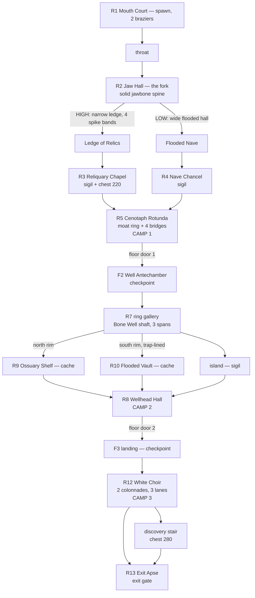

# Level 2 — “Ngã Ba Cốt Trắng” redesign concept (candidate B)

Authoring authority: `tools/design/level2_ossuary_author.py`
Output: `data/levels/chapter_1_level_2.json` (LevelSchema v2, 16 px cells)
Baseline compared against: `1c21a49c2eb3775c4b421dab86d057c7256f5964`

> Submitted as Gate 0 material and kept current with the built prototype. Where
> this document and the JSON disagree, the JSON and the authoring script win.

---

## 1. The one idea

The baseline Level 2 is three repetitions of *left entry → central square room →
right wing*, mirrored on every floor: a 112×80 field of 24×14 grey rectangles.
It is technically a fork, but the two “branches” are the same corridor with a
different enemy count, so the route choice costs the player nothing.

The redesign makes the fork **physical**. The ossuary is one body:

- **Floor 1 — the jaw.** A mouth court narrows into a throat, and the hall beyond
  is split by a *solid jawbone spine* with hanging teeth. The upper teeth open onto
  a narrow, bright **Ledge of Relics**; the lower teeth open onto a wide, dark
  **Flooded Nave**. The two roads are different *kinds of space*, not different
  enemy counts: a 4-cell exposed shelf vs an 11-cell flooded hall.
- **Floor 2 — the throat.** Everything funnels into a ring gallery around a real
  void (the **Bone Well**). The shaft is carved out of the floor mask, so it is a
  genuine hole with a Knight-wide rim, three plank spans, and one island where the
  ring sigil sits. The ring is a loop: you choose a rim, meet a different cache and
  a different trap signature, and come out at the same wellhead.
- **Floor 3 — the voice.** The floor opens into a **White Choir**: two colonnades
  over three lanes, a lit processional lane, an apse with the exit gate, and a
  discovery stair behind the apse that holds the richest chest in the level.

The three floors are three different *architectural verbs* — split, fall, sing —
and none of them repeats the baseline's left-entry formula.

## 2. Traversal graph



ASCII view of the route skeleton (not to scale; `>` and `<` are the two rims):

```
F1   [R1]--[throat]--[JAW HALL]
                        |  |  \
        high (ledge) ---+  |   +--- low (nave)
             |             |             |
      [Reliquary Chapel]  |      [Nave Chancel]
             |             |             |
             +------> [CENOTAPH ROTUNDA] <---+
                          (camp 1, moat, 4 bridges)
                                    | floor door
F2                       [Well Antechamber]
                                    |
                 +------ north rim --+-- south rim ------+
                 |                  (ISLAND)              |
            [Ossuary Shelf]           |            [Flooded Vault]
                 +------- [WELLHEAD HALL] (camp 2) -------+
                                    | floor door
F3                            [F3 landing]
                                    |
                       [WHITE CHOIR] (camp 3, 3 lanes)
                              |            \
                        [EXIT APSE]     [discovery stair]
                              |            /
                           exit gate <----+
```

## 3. The two route decisions

### Decision A — Floor 1: the Ledge or the Nave

| | HIGH — Ledge of Relics | LOW — Flooded Nave |
| --- | --- | --- |
| width | 5–6 cells, dog-legged, three notches | 10–12 cells, one long hall |
| light | braziers every jog, lit lane inlay | two braziers at the ends, dark middle |
| traps | 4 spike bands on the lane itself | 3 spike bands, all avoidable with room to circle |
| reward | Reliquary Chapel: sigil **and** chest (+220) | Nave Chancel: sigil only |
| measured path | spawn → sigil 124 cells → rotunda 56 cells | spawn → sigil 126 cells → rotunda 48 cells |
| fantasy | exposed, fast, greedy | safe, slow, atmospheric |

Both approaches cost 174–180 cells to reach the rotunda, so the decision is not
“short way vs long way” — it is **narrow-and-greedy vs wide-and-patient**, and the
choice is legible from the fork because the spine blocks line of sight: the player
sees the teeth and picks a gap.

After the chapel, a neck at `(119,13,12,4)` rejoins the rotunda directly. The high
road therefore recombines *at the rotunda*, not back at the fork (verified: the
124+56 route above is the real Knight-clear path, not a detour through the nave).

### Decision B — Floor 2: which rim of the well

The ring gallery is a loop around a genuine hole (a 24×11 ellipse removed from the
floor mask, 3 static spans, 1 island). Both rims measure 153 and 155 cells from
landing to the floor-3 door — again deliberately **not** a length difference:

- **North rim** — safe floor, coffin shelves along the wall, leads to the Ossuary
  Shelf cache and arrives at camp 2 from above (you get the high ground of the
  wellhead).
- **South rim** — four spike bands and a flooded vault, arrives at camp 2 from
  below, next to the south cache.

Both rims deliver the player to the same convergence, so an exploration-minded
player can clear one rim, take the island, and come back the other way with the
second cache as the payoff. Camp 2 sits on the east neck where the rims converge,
so whichever rim you take, the fight starts from a different angle — the room is
the reward for the earlier choice.

## 4. Pacing, pressure and recovery

```
pressure
  ^
  |        spike        CAMP 1            trap        CAMP 2         CAMP 3
  |       /     \       /   \            /   \       /    \        /     \
  |      /       \     /     \          /     \     /      \      /       \
  |-----+---------+---+-------+--------+-------+---+--------+----+---------+--> time
   spawn  ledge      rotunda   floor door  ring          wellhead     choir   exit
          OR nave                (rest)   gallery        (rest)               (exit
                                                                          breather)
```

- **Pressure beats:** ledge spikes → camp 1 (5 skeletons around the cenotaph, in
  the open, ringed by a moat so you can retreat across a bridge but not kite into
  the void) → trap lane on one rim → camp 2 in the east neck (5 skeletons with the
  well at their back) → camp 3 in the choir (two colonnades break the charge into
  lanes).
- **Rest beats:** both floor landings (`l2_f2_landing`, `l2_f3_landing`) are
  checkpoint rooms with no enemies, and each camp declares `breather_after`.
  The F2 wellhead is a `breather` room between camp 2 and the floor-3 door.
- **Exploration:** three optional payoffs — the +220 chest on the high road, the
  north cache on the safe rim, the +280 chest behind the exit apse. None gates the
  exit; all three are visible or signposted from a main route.
- **Objective spine:** 4 sigils authored, 3 required. A player can skip the high
  road entirely (rotunda via nave), or skip the S cache, and still finish.

## 5. Landmarks and visual language

| floor | landmark | how it reads |
| --- | --- | --- |
| F1 | **Jawbone spine** — a 26×4 solid bar with four hanging teeth, over a black chasm | silhouette in the first 3 seconds; the two gaps *are* the choice |
| F1 | **Cenotaph Rotunda** — octagonal hall, sunken moat ring carved to void, four bridges, cenotaph island | the only radial space in the level; camp 1 reads as a ring fight |
| F1 | **North balcony** over the jaw | first vertical view of the fork before committing |
| F2 | **Bone Well** — elliptical shaft, three plank spans, island | negative space as the centrepiece; the ring is walked *around* it |
| F2 | **Wellhead Hall** — octagon with four braziers and two statues | convergence room, must feel like an arrival |
| F3 | **White Choir** — 5+5 colonnade piers, three lanes, bier rows, lit processional | the only room with rhythm and repetition — earned, because it is the finale |

Palette, using only the shipped `dungeon_tileset_ii.png` (`source 0`) families:

| role | atlas cells | use |
| --- | --- | --- |
| base flagstone | `(1,4) (2,4) (3,4)` | general floor |
| ossuary niche paving | `(1,12) (2,12)` | rotunda, wellhead, choir, caches |
| lit lane / candle stub | `(3,12) (4,12)` | bridges, processional strips, span planks (accent only) |
| collapse / hole | `(1,6) (2,6)` | sparse, ≤4 % of a material |
| sunken shoulder | `(1,5) (2,5) (3,5)` | around deep zones |
| water lip | `(4,4) (5,4) (6,4)` | north edge of every `deep` zone |
| walls | `atlas_walls_low.png` (`source 1`, 12×4) autotiled by neighbour mask | rock mass, 2-cell lip |

Decor is drawn from props already in the atlas (`(4,3)-(6,3)` braziers,
`(5,5)/(6,5)` biers, `(23,1)/(24,1)` and `(23,7)/(24,7)` gravestones,
`(27,9)/(28,9)` statues, `(2,6)/(3,6)` candles), 132 placements, all on
`Decor` (z 2, non-blocking) and never on a lane centre that a fight needs.

## 6. Exact reuse — nothing invented

- TileSet sources: `0` (`dungeon_tileset_ii.png`, 512×512, 32×32 atlas of 16 px
  cells) and `1` (`atlas_walls_low.png`, 12×4), both already bound in
  `game/levels/dungeon_level.gd`.
- Scene/layer contract unchanged: `Backdrop` z −10 (playable), `Geometry`
  (solid), `Decor` z 2 (non-blocking), `AuthoringEntities` z 20.
- Entity types: only `player, skeleton, floor_door, sigil, checkpoint, exit_gate,
  chest, spikes, torch, coin` — the exact 64 baseline IDs, same types.
- No new schema fields. `metadata.rooms`, `combat_camps`, `required_sigils 3`,
  `camera_bounds` are regenerated from the new geometry; `layout_profile` becomes
  `three_floor_jawbone_fork_bone_well_choir`, which the audit flags as an expected
  informational change (no runtime consumer switches on it).

## 7. Risks to legacy objectives, and how they are contained

| risk | containment |
| --- | --- |
| Room anchor IDs consumed by objective/spawn/mid/end tests move out of their new floor | all 13 IDs kept; rects derived from the real geometry via `room_rect()`, so they always contain floor |
| Capture harness centres `l2_f2_ring` / `l2_f3_exit` camera | both rects are large and centred on the well and the apse; the centre-most Backdrop cell is inside the landmark |
| Door pairs stop being reciprocal after repositioning | `resolve_entities()` snaps doors onto floor and mirrors `target_position`; `level2_contract_check.py` asserts reciprocity and arrival clearance |
| An entity ends up in a wall, or in the new moat/shaft void | every marker is snapped to the floor mask after all carve/refill passes; contract check fails hard otherwise |
| Camp members drift outside their camp rect / patrol into walls | camps are re-derived from the new rooms and the checker re-runs patrol and rect membership |
| Regeneration erases the redesign | `generate_chapter_1_levels_2_to_5.gd` no longer authors Level 2 and prints a pointer to the Python authority |
| The wide level (2624×2208 px) breaks the camera | `camera_bounds` is written from the real size; the Godot capture frames at 1280×720 are the proof |

## 8. Differences from baseline (summary)

| | baseline `1c21a49` | candidate B |
| --- | --- | --- |
| size | 112×80 (1792×1280 px) | 164×138 (2624×2208 px) |
| floor cells | 4,460 | 8,057 |
| geometry | 1,134 | 3,927 |
| decor | 25 | 132 |
| room grammar | 24×14 rectangles, three repeats | octagons, dog-leg ledges, ellipse ring with a hole, colonnade hall |
| fork | two symmetric corridors | one split hall, high ledge vs flooded nave, different width/light/reward |
| landmark | none (holes punched in rectangles) | jawbone spine, moat rotunda, bone well, choir colonnade |
| floor 2 | square room, square hole | ring gallery around a carved shaft with spans and an island |
| floor 3 | square room + side box | three-lane colonnade, apse, discovery stair |
| entities | 64 | 64 (all repositioned, none added or removed) |

Measured diff (`python3 tools/design/level2_audition_audit.py`): footprint
symmetric difference **9,037 cells**, Jaccard **0.161**, 64/64 entities moved,
no new IDs, no immutable-contract violations.
