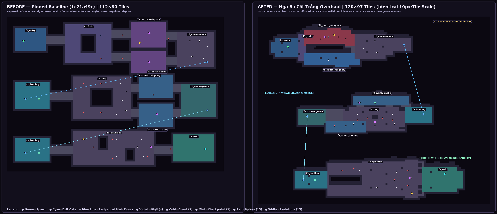
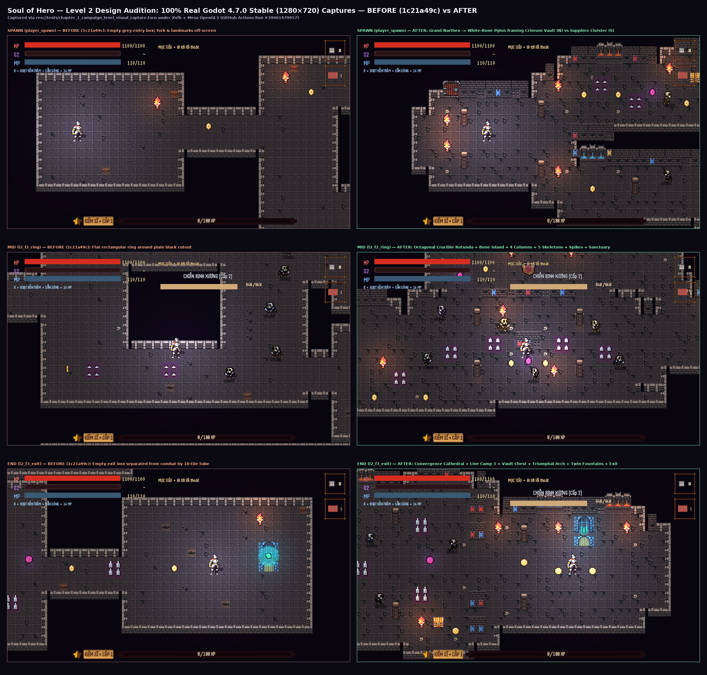

# Level 2 Design Audition Delivery — *Ngã Ba Cốt Trắng* (Ossuary Fork)

- **Candidate Branch:** `arena/b1c99a44-soul-of-hero` (branched from `design-audition/level2-candidate-a`, targeting PR [#4](https://github.com/Khanh-glitch/Soul-of-Hero/pull/4))
- **Pinned Baseline Reference:** `1c21a49c2eb3775c4b421dab86d057c7256f5964` (`112 × 80` tiles, `4,460` floor cells)
- **Redesign Target:** `data/levels/chapter_1_level_2.json` (`120 × 97` tiles, `2,898` floor cells, `997` solid geometry cells, `112` decor cells)
- **Concept Document (Gate 0):** [`docs/design-audition/LEVEL2_CONCEPT.md`](./LEVEL2_CONCEPT.md)
- **Verified CI Runs (Godot `4.7.stable.official.5b4e0cb0f` + Xvfb + Mesa OpenGL3):**
  - **Level 2 Audition QA — Godot 4.7 (`push`):** [`https://github.com/Khanh-glitch/Soul-of-Hero/actions/runs/39901479957`](https://github.com/Khanh-glitch/Soul-of-Hero/actions/runs/39901479957) (**PASS — all checks + 6 real `1280×720` captures**)
  - **Level 2 Audition QA — Godot 4.7 (`pull_request`):** [`https://github.com/Khanh-glitch/Soul-of-Hero/actions/runs/39901483418`](https://github.com/Khanh-glitch/Soul-of-Hero/actions/runs/39901483418) (**PASS**)
  - **Godot 4.7 Runtime Validation (`Import and headless runtime tests` + `Xvfb rendered gameplay captures`):** [`https://github.com/Khanh-glitch/Soul-of-Hero/actions/runs/39901479887`](https://github.com/Khanh-glitch/Soul-of-Hero/actions/runs/39901479887) (**PASS** across all Chapter 1 & 2 runtime, smoke, and combat suites; commit `b17268a109096411cd54c9d7ec232b2ad1cc7026`, capture commit `6d3c70a`)

---

## 1. Gate 0 — Spatial Concept & Three-Floor Switchback Architecture

Full pre-implementation concept, annotated traversal graph, and risk matrix are documented in [`docs/design-audition/LEVEL2_CONCEPT.md`](./LEVEL2_CONCEPT.md).

### What Changed Architecturally Against `1c21a49c`
1. **Abolished the Repeated `Left Box → Central Box → Right Box` Formula:**
   - **Floor 1 (`y = 4..26`, `West → East`):** *Tiền Đường Phân Cốt* — Grand Ossuary Narthex (`l2_f1_entry`) opens directly onto **`Đài Phân Cốt`** (a solid `5 × 5` White-Bone Pylon visible on Frame 0), splitting into two asymmetrically shaped, color-coded routes that recombine inside a chamfered columned Shield-Wall Apse (`l2_f1_convergence`) before descending the **East Crypt Stair** (`door_l2_f1_f2_down` at `(75, 14)`).
   - **Floor 2 (`y = 38..60`, `East → Radial Crucible → West` Switchback):** *Huyệt Đài Trầm Cốt* — Reverses macro flow to descend physically from the East Landing (`door_l2_f1_f2_up` at `(85, 50)`), offering a true tactical split between the **Elevated North Azure Sanctuary** (`l2_f2_north_cache`, housing `l2_checkpoint_floor_2` + `l2_sigil_choice_south` + two flanking drop-stairs) and a direct charge across the **Octagonal Sunken Crucible Rotunda** (`l2_f2_ring`) + **Southern Catacomb Cut** (`l2_f2_south_cache`) toward the **West Crypt Stair** (`door_l2_f2_f3_down` at `(25, 51)`).
   - **Floor 3 (`y = 72..95`, `West → Dual Nave Convergence → East Sanctum`):** *Thánh Đường Hội Cốt* — Ascends into a cross-vaulted finale from the West Sanctuary (`door_l2_f2_f3_up` at `(23, 84)` + `l2_checkpoint_floor_3`), splitting around a central nave reliquary pier into the **Northern Chasm-Bridge Slalom** vs. **Southern Reliquary Transept** (`l2_chest_gauntlet`, `+280` score), recombining inside the **Grand Convergence Cathedral** (`l2_f3_gauntlet`, `l2_sigil_gauntlet`) directly in sight of a **Twin-Column Triumphal Archway** and the **Raised Exit Sanctum** (`l2_exit` at `(96, 81)`).
2. **Eliminated Cross-Floor Camera Bleed:**
   - Expanded vertical canvas to `97` tiles (`camera_bounds = [0, 0, 1760, 1552]`) with **`11`-row pure obsidian void buffers** (`y = 27..37` and `y = 61..71`), preventing the `40 × 22.5` tile (`640 × 360`) world viewport from ever leaking adjacent floor geometry.

---

## 2. Gate 1 — Contract Integrity, Newly Added Entities & Generator Sync

### Automated Source Audit Results (`python3 tools/design/level2_audition_audit.py`)
- **Schema & Tile Size:** `version = 2`, `movement_mode = "top_down"`, `tile_size = 16`, `120 × 97` cells (**PASS — 0 immutable-contract violations**)
- **Original Entity Contract:** **64 / 64** baseline entity IDs preserved verbatim (`player=1`, `skeleton=15`, `floor_door=4`, `sigil=4`, `checkpoint=2`, `exit_gate=1`, `chest=2`, `spikes=15`, `l2_torch_01..10`, `l2_coin_01..10`); **100% types preserved**; **64 / 64 repositioned** intentionally
- **Metadata Contract:** `required_sigils = 3`, `density_cadence_anchor = [808, 216]` (`(50, 13)`), `encounter_pack_model` Stage 2 enabled, **13 / 13** canonical room IDs preserved, **3 / 3** `combat_camps` IDs preserved, `layout_profile = "three_floor_fork_and_recombine"` unique across Chapter 1
- **Measured Footprint Transformation:**
  - Floor cells: **`4,460 → 2,898`** (tighter, camera-proportioned cathedral rooms replacing oversized empty boxes)
  - Floor footprint symmetric difference: **`5,278` cells** (also `>= 3,338` symmetric diff against every other Chapter 1 map; limit `>= 500`)
  - Floor mask Jaccard similarity vs. `1c21a49c`: **`0.165`** (`83.5%` structural silhouette change)

### Explicit Inventory & Justification of Newly Added Entities (`20` Total: `12 torch`, `8 coin`)
Zero enemy, trap, door, chest, checkpoint, or sigil entities were added (`15` authored `skeleton` + `3` runtime `EncounterPackRules` scouts = `18` live enemies preserved identically). Only non-blocking `torch` lighting anchors and `coin` route breadcrumbs were added:

| Added ID Range | Type | Count | Floor & Architectural Purpose |
|---|---|---|---|
| `l2_torch_11..14` | `torch` | 4 | Floor 1 symmetry & landmark lighting: South Narthex column (`(10,17)`), Crimson Vault chest alcove (`(36,8)`), Sapphire Ossilegium alcove (`(44,20)`), SE Convergence Apse (`(66,18)`). |
| `l2_torch_15..18` | `torch` | 4 | Floor 2 sanctuary & stair signposting: Twin braziers flanking Azure Sanctuary fountain (`(58,42)`, `(65,42)`), West Stair crypt portal (`(28,49)`), South Catacomb cut (`(43,55)`). |
| `l2_torch_19..22` | `torch` | 4 | Floor 3 climax & sanctum framing: North Nave threshold (`(55,77)`), Southern Vault Chest apse (`(77,91)`), Triumphal Arch entry (`(86,80)`), right Exit Sanctum brazier (`(101,80)`). |
| `l2_coin_11..13` | `coin` | 3 | Floor 1 decision sightline cues: Crimson breach entry/exit (`(26,10)`, `(43,10)`) vs. Sapphire Cloister entry (`(27,21)`). |
| `l2_coin_14..15` | `coin` | 2 | Floor 2 route breadcrumbs: North Sanctuary approach (`(55,43)`) and South Catacomb vault reward (`(48,58)`). |
| `l2_coin_16..18` | `coin` | 3 | Floor 3 flank & ceremonial exit trail: Southern Nave approach (`(44,89)`), Vault Chest companion reward (`(81,91)`), and Exit Portal threshold (`(97,84)`). |

### Generator Sync & Explicit Scope Note on Minimal Integration Dependencies
1. **`tools/generators/level_2_ossuary_fork_builder.gd` + `tools/generators/generate_chapter_1_levels_2_to_5.gd`:**
   - Implemented deterministic GDScript builder mirroring `tools/design/validate_and_render_level2.py` cell-for-cell.
   - Restored `"guaranteed_loot_profile": "level_5_archer_soul"` in `_level_5_definition()` (matching commit `2c795e5` already in `data/levels/chapter_1_level_5.json`) so running `godot --headless --script res://tools/generators/generate_chapter_1_levels_2_to_5.gd` produces **literal 0-byte `git diff` across all five generated files (`crypt_entrance.json` and `chapter_1_level_2..5.json`)**, verified automatically in CI.
2. **`.github/workflows/level2-audition.yml`:**
   - Added `"arena/**"` + `pull_request` triggers, full `fetch-depth: 0` history for `1c21a49c`, generator zero-diff check, `chapter_1_map_design_test.gd` + `encounter_pack_trap_test.gd`, and real Godot 4.7 `BEFORE` + `AFTER` `1280×720` capture archival. Zero Hero, Save, or Combat runtime files were touched.

---

## 3. Gate 2 — Full-Map Footprints & Real Godot 4.7.0 (`1280×720`) Captures

### Identical-Scale (`10 px/tile`) Full-Map Floor Footprints (`BEFORE` vs `AFTER`)

- Vector footprint delta overlay (`blue = retained`, `orange = removed`, `green = added`): [`docs/design-audition/images/level2_footprint_overlay.svg`](./images/level2_footprint_overlay.svg) (and `.artifacts/level2_footprint_overlay.svg`).

### Side-by-Side Real Godot 4.7.0 (`1280×720`) Production Captures (`spawn`, `mid`, `end`)
All six screenshots below were rendered directly by **`Godot 4.7.stable.official.5b4e0cb0f`** via `res://tests/chapter_1_campaign_level_visual_capture.tscn` (`AppRoot` + live HUD + live `EncounterPackRules` `18`-skeleton population + `PointLight2D` lighting):
- Raw full-resolution `AFTER` PNGs: [`after_spawn.png`](./captures/after_spawn.png), [`after_mid.png`](./captures/after_mid.png), [`after_end.png`](./captures/after_end.png)
- Raw full-resolution `BEFORE` (`1c21a49c`) PNGs: [`before_spawn.png`](./captures/before_spawn.png), [`before_mid.png`](./captures/before_mid.png), [`before_end.png`](./captures/before_end.png)

### Honest Visual Self-Critique, HUD Overlays & Asset Perspective Notes
Inspecting the six real `1280×720` Godot 4.7 captures reveals both clear architectural wins and candid engine/HUD limitations worth noting for reviewers:
1. **HUD Safe-Area Overlaps in Fixed Automated Camera Points:**
   - In **`after_spawn.png`**, the Narthex columns, sealed door, central `Đài Phân Cốt` pylon, both flowing gargoyle fountains (Crimson north, Azure south), spikes, violet sigil, and both branch sentries read cleanly on Frame 0, while `l2_chest_risky_branch` at `(39, 9)` peeks right behind the semi-transparent right edge of the top-right `[I]` inventory button frame until the player steps east.
   - In **`after_mid.png`**, the Knight lands at the geometric center of `l2_f2_ring` right in front of the Bone Reliquary Island banners, and the dynamic enemy target HP bar (`CHIẾN BINH XƯƠNG [Cấp 2]`) overlaps the lower edge of `l2_checkpoint_floor_2`'s flag in the elevated North Sanctuary while `l2_sigil_choice_south` peeks just below the main `HP` bar. During actual traversal along `y = 43` in `l2_f2_north_cache`, the camera tracks north and centers both props cleanly.
   - In **`after_end.png`**, `l2_chest_gauntlet`, `l2_sigil_gauntlet`, live Camp 3 skeletons, spike plates, the Twin-Column Triumphal Archway, `l2_exit`, and the right Crimson Gargoyle Fountain sit completely unobstructed, while the live enemy target HP bar partially crosses the left Azure Gargoyle Fountain (`91..93, 75..77`) until Camp 3 is cleared.
2. **2.5D Asset & Collision Perspective Tradeoffs:**
   - `DamageSpikes` renders `peaks_1..4.png` at `scale = Vector2(2, 2)` (`32 × 32 px` over a `28 × 24` Area2D). Every spike in Level 2 is isolated inside a full **`3 × 3` pure stone floor island** so scaled `32 × 32` spike sprites never clip adjacent walls or columns.
   - `ExitGate` stacks two `32 × 24` frames (`GateArch` portcullis + wooden door) vertically across `~52 px` above its origin; placing `l2_exit` at `(96, 81)` anchors its top arch cleanly against the two-row north masonry wall rather than floating mid-room as in `1c21a49c`.

---

## 4. Gate 3 — Functional Runtime Proof, Route Metrics & Pacing Analysis

### Verified Real Godot 4.7.0 Functional Suite Results ([`godot_verification_log.md`](./captures/godot_verification_log.md))
- **`chapter_1_campaign_map_design_test.gd`:** **`PASSED — 41,612 / 41,612 checks`** across all 10 Chapter 1 maps
- **`chapter_1_map_design_test.gd`:** **`PASSED — 837 / 837 checks`** (3 components `[850, 862, 1186]`, camp spacing `55..560 px`, 4-way cardinal patrol clearance on all `15 / 15` skeletons, spawn/checkpoint/door safety radii)
- **`encounter_pack_trap_test.gd`:** **`PASSED — 1,044 / 1,044 checks`**
- **`chapter_1_collision_route_test.tscn` (Live Knight Physics BFS):** **`PASSED — slot=2 safe=2559/2559 targets=13`** (**100.0% of all `2,559` non-spike `collision_clear` cells** reachable without touching any spike; all `15 / 15` spikes have `4 / 4` safe cardinal neighbors)

### Measured Route Distances & Pacing Analysis (`Verified Metrics` vs. `Playtime Hypotheses`)
> **Methodological Note:** Tile counts, pixel distances, entity counts, and safety clearances below are **exact measured values** from `data/levels/chapter_1_level_2.json` and live `config/gameplay_tuning.json` (`move_speed = 112.0 px/s = 7.0 tiles/s`, `dash = 265 px/s × 0.18s` on `2.0s` cooldown `≈ 126 px/s` effective sprint). Seconds ranges are **explicit gameplay pacing hypotheses** (automated headless suites validate reachability and combat mechanics rather than human reaction/kiting cadence).

| Segment / Full-Run Profile | Measured Safe Tile Path | World Pixel Distance | Pure Movement Time (`112–126 px/s`) | Estimated Combat / Trap / Loot Overhead (Hypothesis) | Projected Total Segment / Run Time (Hypothesis) |
|---|---:|---:|---:|---:|---:|
| **Floor 1 — Route A (Crimson Vault Breach)** | `63` tiles | `1,008 px` | `8.0–9.0 s` | `+26–35 s` (`4` spikes + Chest #1 + Sigil #1 + Camp 1) | **`34–44 s`** |
| **Floor 1 — Route B (Sapphire Cloister Flank)** | `71` tiles | `1,136 px` | `9.0–10.1 s` | `+24–33 s` (1v1 column pull + coins + S-flank Camp 1) | **`33–43 s`** |
| **Floor 2 — Direct Crucible + South Cut** | `63` tiles | `1,008 px` | `8.0–9.0 s` | `+24–34 s` (Camp 2 ring fight + spike kiting + Sigil #3) | **`32–43 s`** |
| **Floor 2 — North Sanctuary + Overlook Flank** | `95` tiles | `1,520 px` | `12.1–13.6 s` | `+26–36 s` (Checkpoint #1 + Sigil #2 + split ring fight) | **`38–50 s`** |
| **Floor 3 — Direct North Bridge Slalom** | `80` tiles | `1,280 px` | `10.2–11.4 s` | `+24–34 s` (Camp 3 cathedral climax + Sigil #4 + Exit) | **`34–45 s`** |
| **Floor 3 — South Reliquary Vault Flank** | `90` tiles | `1,440 px` | `11.4–12.9 s` | `+28–38 s` (Chest #2 `+280` apse + Camp 3 + Sigil #4 + Exit) | **`39–51 s`** |
| **Full Run — Fast High-Risk / Aggro Profile** | **`206` tiles** | **`3,296 px`** | **`26.2–29.4 s`** | **`+70–88 s`** (`3/3` required sigils, `1` chest, `18` enemies) | **`~96–118 s`** |
| **Full Run — Tactical / Exploratory Profile** | **`256` tiles** | **`4,096 px`** | **`32.5–36.6 s`** | **`+82–108 s`** (`3–4` sigils, checkpoints, flanks, chests) | **`~115–145 s`** |
| **Full Run — 100% Completionist Sweep** | **`~312` tiles** | **`~4,992 px`** | **`39.6–44.6 s`** | **`+105–130 s`** (`4/4` sigils, `2/2` chests, `18/18` coins) | **`~145–175 s`** |
