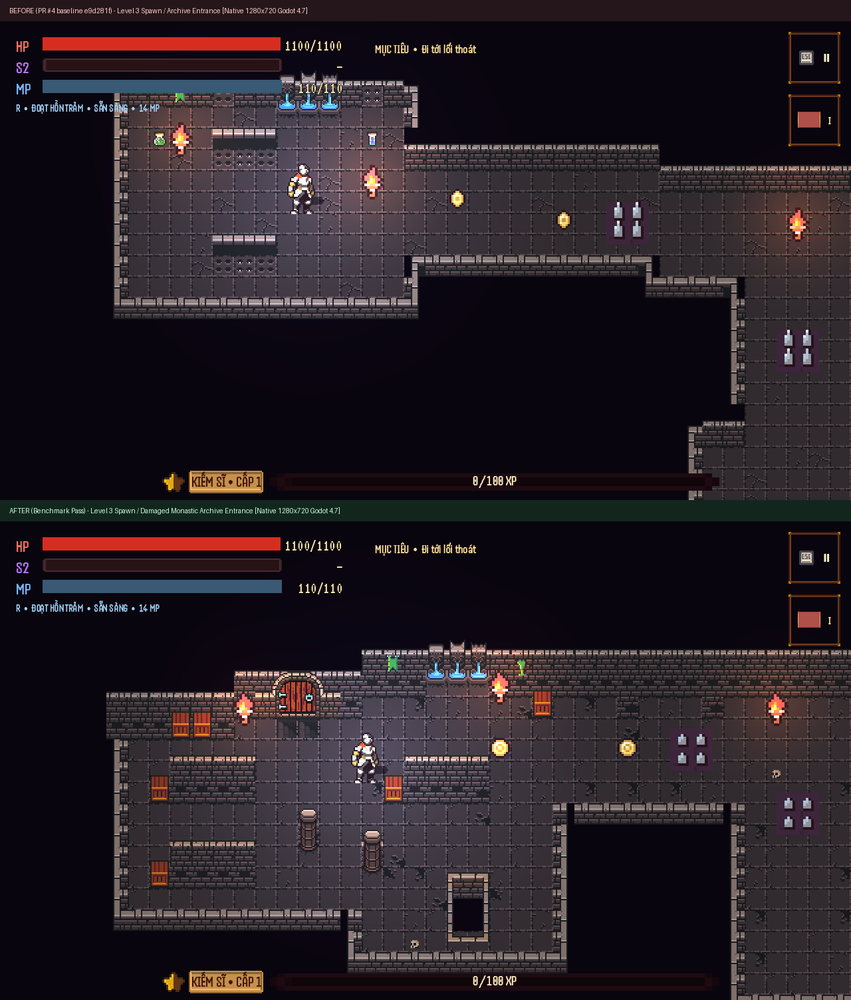
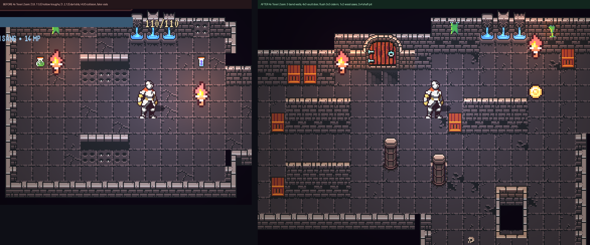
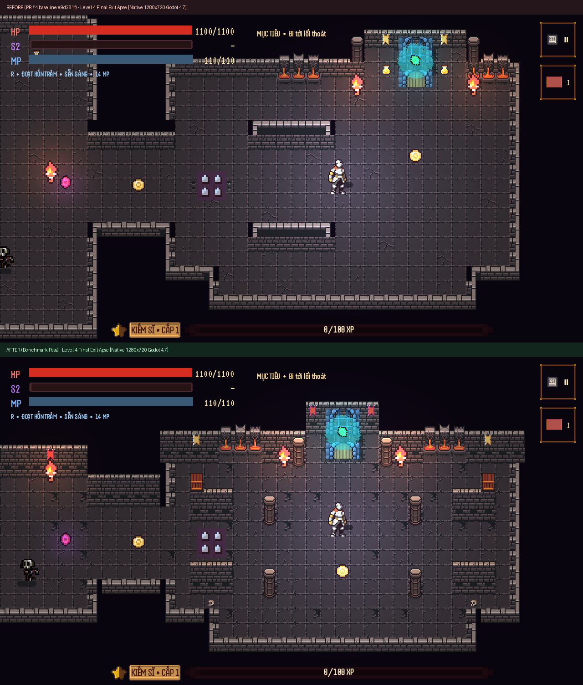
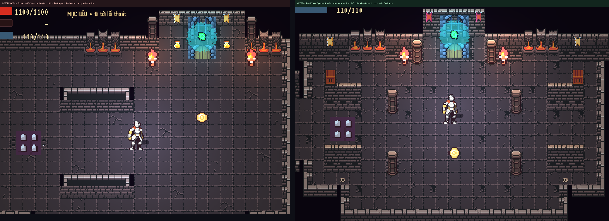

# Two-Location Visual Execution Benchmark (Levels 3 & 4 — PR #4)

Scope is restricted strictly to the **two requested sample locations** (plus minimal local boundary connections):
1. **Level 3 — Spawn / Archive Entrance** (`tools/generators/level_3_crossfire_archive_builder.gd` → `data/levels/chapter_1_level_3.json`)
2. **Level 4 — Final Exit Apse** (`tools/generators/level_4_spiral_reliquary_builder.gd` → `data/levels/chapter_1_level_4.json`)

No other rooms, campaign levels, shared gameplay scripts/scenes (`game/**`), accepted Level 2 assets/docs, or test thresholds (`tests/**`) were modified.

---

## 1. Level 3 — Spawn / Damaged Monastic Archive Entrance

### Full Native `1280×720` Godot 4.7 Comparison
- Raw `1280×720` BEFORE (`e9d281f`): [`captures/prev_e9d281f_l3_spawn.png`](captures/prev_e9d281f_l3_spawn.png)
- Raw `1280×720` AFTER: [`captures/after_l3_spawn.png`](captures/after_l3_spawn.png)

### `4×` Integer Texel Close-Up (`dungeon_tileset_ii.png` Multi-Tile Verification)

### What Changed & Honest Asset Disclosure
- **Removed:** All sewer/arrow-slit tiles (`[0, 1..2, 12]`), hollow planter/trough rims (`[1, 8..11, 0]`), flat mud-fill tiles (`[0, 6, 7]` / `[0, 4, 6]`), non-collectible floor potion decals, and top-left HUD bar collisions (`y = 7..19` steps clear under `HP / S2 / MP`, `MỤC TIÊU`, `ESC II`, `I`, and bottom `XP` bar).
- **Assembled from verified full-sheet tiles:**
  - `3`-band cut-stone north & stack walls (`[0, 2, 0]` coping + `[0, 1..2, 1]` mid-masonry + `[0, 3, 2]` base brick) forming two parallel monastic stack bays with recessed `1×2` wooden storage cases (`[0, 18, 25..26]`).
  - Complete `4×3` arched oak vault door (`[0, 1..4, 13..15]`) leading to the upper archive stacks, flanked by intact (`[0, 5, 5..7]`) and cracked (`[0, 6, 5..6]` + carved plinth `[0, 5, 7]`) `1×3` stone columns.
  - Flush `3×3` ruptured stone water cistern (`[0, 6..8, 2..4]`), moss seepage spout (`[0, 4, 5]`), floor cracks (`[0, 1..3, 5]`), and a `2×4` sunken collapse shaft (`[0, 7..8, 12..15]`) connecting structurally into the lower chasm.
- **Explicit Asset-Library Limitation:** Neither shared tileset (`assets/tilesets/dungeon/dungeon_tileset_ii.png`, `256×256`, nor `assets/environments/raou_dungeon/atlas_walls_low.png`, `208×144`) contains books, scrolls, lecterns, or shelving sprites. Rather than faking books with grates/sewer slits, the room depicts stripped monastic stone storage bays, plain timber cases (`1×2`), a sealed vault door (`4×3`), water-damaged masonry, and structural collapse. Without custom library props, its identity reads first as a damaged stone vault/repository rather than a literal book-lined library.

---

## 2. Level 4 — Final Exit Apse

### Full Native `1280×720` Godot 4.7 Comparison
- Raw `1280×720` BEFORE (`e9d281f`): [`captures/prev_e9d281f_l4_end.png`](captures/prev_e9d281f_l4_end.png)
- Raw `1280×720` AFTER: [`captures/after_l4_end.png`](captures/after_l4_end.png)

### `4×` Integer Texel Close-Up (`dungeon_tileset_ii.png` Multi-Tile Verification)

### What Changed & Remaining Scene Constraint
- **Fixed multi-tile overwrite & cropped assemblies:**
  - Eliminated the `(108, 79)` collision where the right column's base overwrote the left edge of the east `3×3` gargoyle lava brazier (`(108..110, 77..79)`).
  - Placed both complete `3×3` gargoyle molten-flame braziers (`[0, 6..8, 2..3]` + `[0, 9..11, 4]`) flush at `(91..93, 81..83)` and `(105..107, 81..83)` with `2`-tile masonry piers separating them from the inner `1×3` sanctuary columns at `(96, 82..84)` and `(102, 82..84)`.
  - Replaced the asymmetric corner pocket, hollow `[1, 8..11, 0]` choir troughs, floating `4×2` exit arch, floor black slits, and fake gold flasks with a symmetric basilica apse centered on `x = 99` (`y = 78..94`), twin `4×3` solid stone choir walls with `1×2` timber sacristy chests, four freestanding `1×3` nave columns (`(94, 87)`, `(104, 87)`, `(94, 92)`, `(104, 92)`), and clean margins clear of every HUD bar.
- **Explicit Shared-Scene Constraint:** `ExitGate` (`game/world/interactables/exit_gate.tscn`, untouched under `game/**`) uses `Rect2(0, 0, 32, 48)` on `doors_lever_chest_animation.png`, rendering the iron portcullis sprite vertically above the `32×16` blue stone arch behind the pulsing cyan portal shader (identical to accepted Level 2's exit gate). The apse niche at `(98..100, 78..83)` is sized around that exact `37×55px` scene sprite so nothing clips or floats, though the shared `ExitGate` sprite geometry itself cannot be changed within level data alone.
