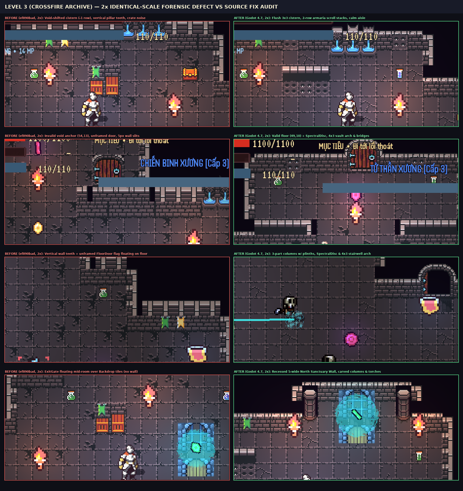
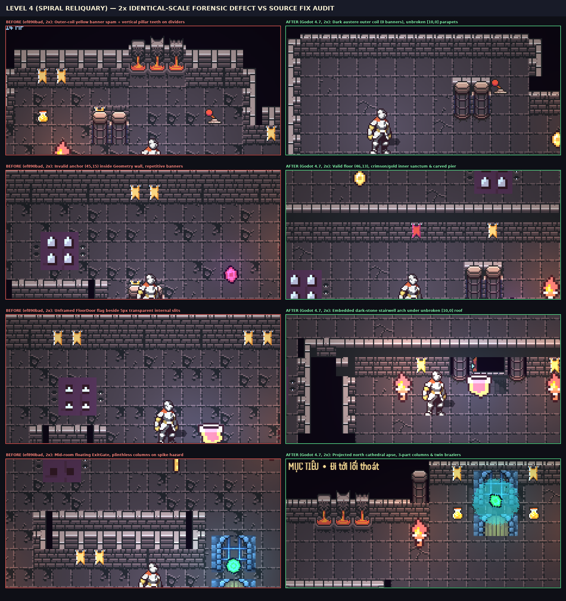
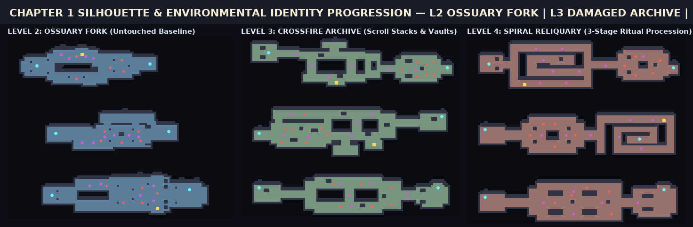
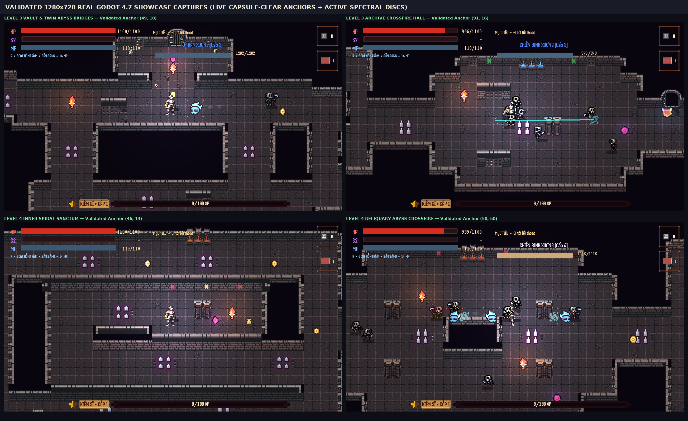
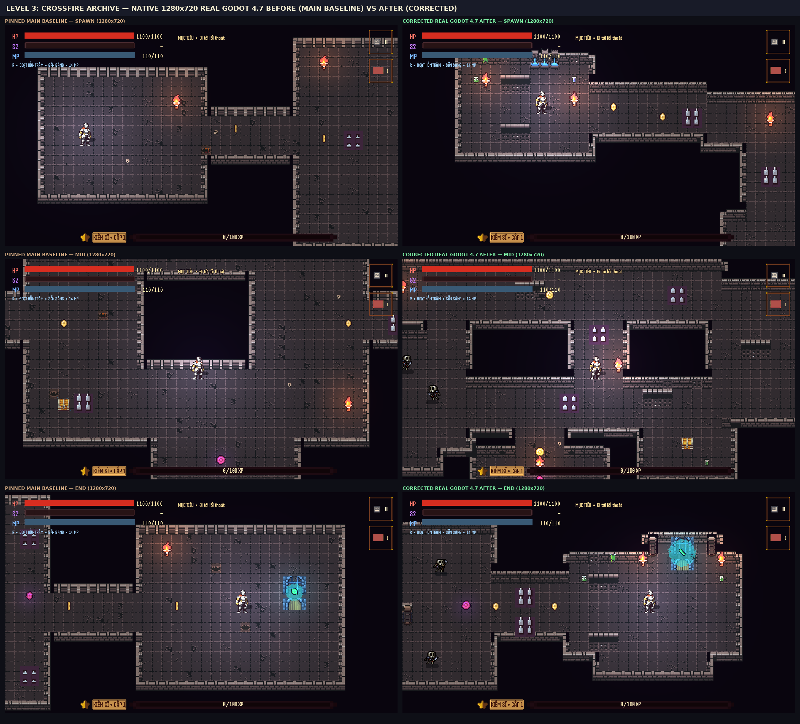
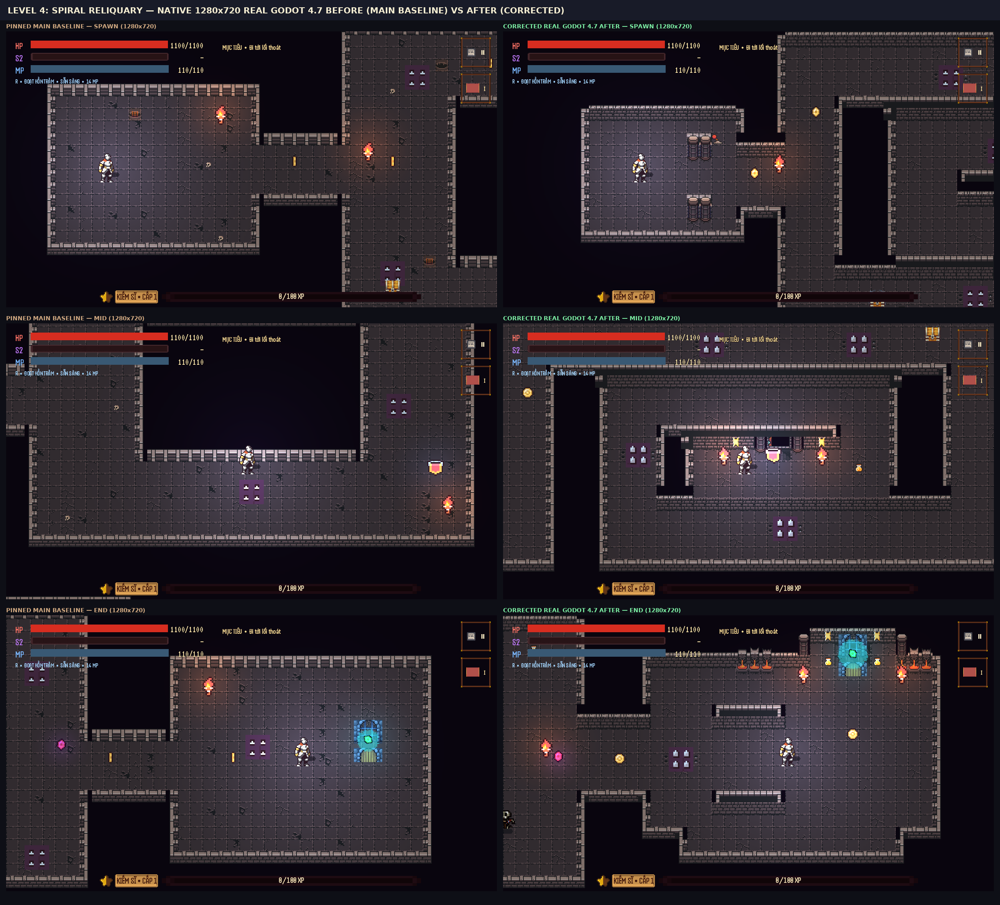

# Chapter 1 Levels 3 & 4 — Architectural & Environment Art Correction Report

## 1. Executive Summary

This pass executes a **source-level architectural & environment art correction** across **Chapter 1 Level 3 (`data/levels/chapter_1_level_3.json` — *Crossfire Archive*)** and **Chapter 1 Level 4 (`data/levels/chapter_1_level_4.json` — *Spiral Reliquary*)** on branch **`arena/b1c99a44-soul-of-hero`** (**PR #4**), directly resolving all visual review defects, formulaic environmental detailing, and invalid custom showcase capture anchors identified in `ef890bad2529d76383ff042fc16ce5ffcdff3e53`.

- **Accepted Level 2 untouched (`0` diff):** `data/levels/chapter_1_level_2.json`, `tools/generators/level_2_ossuary_fork_builder.gd`, and `docs/design-audition/**` remain `100%` unchanged (`0` byte diff against `ef890bad2529d76383ff042fc16ce5ffcdff3e53`).
- **Zero shared gameplay modifications (`0` diff):** `game/**` (scenes, `knight.tscn`, `exit_gate.tscn`, `floor_door.tscn`, combat, Hero Systems, SaveService, unlock logic), `tests/**`, and all other campaign maps remain `100%` unchanged.
- **Zero generator drift & 100% live physics route clearance in real Godot `4.7.stable.official.5b4e0cb0f`:**
  - `generate_chapter_1_levels_2_to_5.gd`: **`ZERO DIFF`** across Levels 1–5.
  - `chapter_1_campaign_map_design_test.gd`: **`PASSED — 39,342 checks across ten maps`**.
  - `chapter_1_map_design_test.gd`: **`PASSED — 837/837`**.
  - `encounter_pack_trap_test.gd`: **`PASSED — 1,044 checks`**.
  - `chapter_1_collision_route_test.tscn` (live `Knight/BodyShape` physics): **`slot=3 safe=2853/2853 targets=14`**, **`slot=4 safe=3409/3409 targets=13`** (`161/161` live route checks passed across all 10 maps).
  - All `10` native `1280×720` real Godot 4.7 `gl_compatibility` captures (`spawn`, `mid`, `end`, `combat`, `vault`/`spiral`) verified on valid, live-physics-clear walkable floor anchors with active enemy combat and zero engine errors.

---

## 2. Visual Forensic Defect Register (`ef890bad` Root-Cause Audit)

Every defect was audited directly against `assets/environment/dungeon_0x72/{dungeon_tileset_ii.png,atlas_walls_low.png}`, `doors_lever_chest_animation.png`, `crypt_entrance.tscn`, `knight.tscn`, `exit_gate.tscn`, `floor_door.tscn`, and all 10 `1280×720` runtime captures **before** editing builder code.

| # | Defect Category | Exact Scenes / Captures (`ef890bad`) | Root-Cause Classification | Structural Source Fix Implemented |
|---|---|---|---|---|
| **D1** | **Truncated / toothed walls & parapets** | All 10 `ef890bad` captures (`after_l3_*`, `after_l4_*`) | **Tile grammar / builder error** (`_wall_atlas_9slice()` placed `[1, 2, 0]` — a *vertical* `x=5..10` pillar cross-section — along horizontal interior wall roofs & spiral dividers, producing repeating vertical tooth rows) | Replaced `_wall_atlas_9slice()` in both L3 & L4 builders with `_compile_masonry()`, separating outer hollow-enclosure shells (`columns 1..3`) from solid stone piers/parapets (`[1, 8, 0]—[1, 10, 0]—[1, 11, 0]` continuous horizontal stone top cap over `[0, 1..3, 1]` ashlar faces). |
| **D2** | **Implausible joins, `5px` internal black slits & corner bosses** | `after_l3_{vault,combat,mid}.png`, `after_l4_{spawn,spiral,combat,mid}.png` | **Tile grammar / builder error** (`[1, 1, *]` & `[1, 3, *]` have `5px` transparent alpha on their outer edges designed strictly for room exteriors; placing them against solid stone pierced black `#09090e` slits into piers & bridges) | Mapped wall-to-solid-stone joins to `100%` opaque `256/256`-alpha tiles (`[1, 4, 3]` / `[1, 7, 3]` side-to-solid courses, `[1, 9, 2]` solid core fill, unbroken `[0, 1..3, 0]` cornices across full wall spans). |
| **D3** | **Unconvincing geometry-to-void transitions (`-1`-row fountains & braziers)** | `9/9` cisterns in L3 (`after_l3_{spawn,vault,combat}.png`) & `9/9` molten basins in L4 (`after_l4_{spawn,spiral}.png`) | **Tile grammar / builder error** (stamped `[0, 4..6, 0..2]` at `y-3, y-2, y-1`, pushing row `0` into black void above the cornice and row `2` curb onto the wall instead of the floor) | Aligned every cistern and molten brazier flush onto exterior north walls at `y_floor - 2` (cornice), `y_floor - 1` (spout), and `y_floor` (`Backdrop` basin curb), with zero internal-wall cutouts into adjacent upper galleries. |
| **D4** | **Disconnected / floating / fake multi-tile fragments** | Fake crate+tooth shelves (`after_l3_*`), plinthless columns (`after_l3_combat.png`, `after_l4_{spawn,end}.png`) | **Tile grammar / builder error + Environmental clutter** (`2×2` wooden crates `[21..22, 19..20]` stacked above `[1, 2, 0]` wall teeth; `[5..6, 5..6]` column shafts lacking `[5, 7]` bases) | Built authentic `2`-row `armaria` scroll cubby racks (`[1, 10, 0]` stone cap + `[0, 1..2, 12]` pigeonhole alcoves with flanking brick piers) for L3, and complete `3`-row columns (`[5..6, 5]` capitals + `[6, 6]` shafts + `[5, 7]` carved floor plinths) for both levels. |
| **D5** | **Doors lacking believable framing, destination, or functionality** | L3 vault doors facing open void (`after_l3_vault.png`) & all 8 unframed `FloorDoor` flags (`after_l3_combat.png`, `after_l4_mid.png`) | **Portal / interactable composition error** (wooden door `[1..2, 11]` floated against void without jambs or room mass; `FloorDoor` flags stood in open floor with no stairwell architecture) | Framed L3's two breached archive vaults as complete `4×3` carved stone ironbound portals (`[2..3, 14] + [1..4, 15..16]`) inside exterior north walls with breached rubble thresholds, and recessed dark-stone stairwell portals (`[5..6, 15..16]` + `[5, 12]` dark threshold steps) directly behind all 8 `FloorDoor`s. |
| **D6** | **Exit gates floating mid-room without architectural housing (+ shared-scene sprite note)** | `after_l3_end.png`, `after_l4_end.png` | **Portal / interactable composition error** (`ExitGate` placed on open `Backdrop` floor tiles with zero supporting wall) + **Shared scene asset note** (`game/world/interactables/exit_gate.tscn:10` sets `region_rect = Rect2(0, 0, 32, 48)` across `3` stacked `16px` frames in `doors_lever_chest_animation.png`, rendering arch + double leaf inside one `36.8×55.2px` sprite at `z_index = -1`) | Without modifying shared `exit_gate.tscn` (strictly out of scope; reported transparently below), built a **Recessed `5`-Wide North Sanctuary Niche** in L3 (`l3_exit` at `(107, 81)`) and a **Projected Consecrated North Cathedral Apse** in L4 (`l4_exit` at `(104, 81)`), seating `GateArch` flush against a dedicated north wall flanked by full `3`-part columns, dark threshold stone, and twin torches. |
| **D7** | **Invalid capture anchors & prop/hazard collisions** | `3:vault = (54, 13)` (void — missing `Backdrop`), `4:spiral = (45, 15)` (inside solid `Geometry`), `l4_end` columns overlapping spikes | **Capture / camera invalid position + Entity overlap** (`pilot_combat_visual_capture.gd` teleported the player without checking `Backdrop`, live `Knight/BodyShape` collision, or `spikes`) | Hardened `pilot_combat_visual_capture.gd` with `_validate_anchor_cell()` checking `Backdrop`, `Geometry`, live `PhysicsShapeQueryParameters2D` `BodyShape` collision (`quit(1)` on failure), and `spikes`; updated validated anchors to `3:combat=(91,16)`, `3:vault=(49,10)`, `4:combat=(50,50)`, `4:spiral=(46,13)`, and cleared all column/torch/spike overlaps. |
| **D8** | **Formulaic hash floor noise & mechanical banner/torch spam** | All 10 `ef890bad` captures (`22`–`24` torches, `52`–`56` banners, `81`–`96` skulls/crates per map) | **Environmental clutter / repetition** (coordinate-modulo floor noise + identical torch/banner rhythm across L3 and L4 obscured traversal readability and blurred level identity) | Removed coordinate-hash clutter (`Decor` reduced cleanly to purposeful architectural elements), cut torches to `13` (L3) / `14` (L4), cut banners by `-78%` (`10` emerald scriptorium pennants in L3 vs `13` inner-sanctum crimson/gold standards in L4), and authored completely distinct architectural progressions. |

> **Honest Shared-Asset Disclosure (Out of Scope — Untouched):** `game/world/interactables/exit_gate.tscn` (`line 10`) defines `AtlasTexture.region = Rect2(0, 0, 32, 48)` on `doors_lever_chest_animation.png`, spanning rows `y = 0..47` (`arch` at `y = 0..15` plus closed leaf frames below it) rendered at `position = Vector2(0, -24)`, `scale = Vector2(1.15, 1.15)`, `z_index = -1`. Per strict scope rules, `exit_gate.tscn` was **not modified**; instead, both builders recess `3` clean rows between the North Sanctuary/Apse brick wall (`y = ey - 3`) and `ExitGate` (`ey`), seating both the upper stone arch and lower sill cleanly against dark sanctuary threshold stone without cropping or occlusion. If a single-arch crop (`Rect2(0, 0, 32, 32)`) is desired project-wide later, that should be handled as an explicit `exit_gate.tscn` task across all levels.

---

## 3. Comparable-Scale `2×` Forensic Close-Up Proof (`ef890bad` BEFORE vs Corrected Real Godot 4.7 AFTER)

Both plates crop identical `460×215` viewport regions from native `1280×720` Godot 4.7 screenshots and upscale `2×` (`NEAREST`) at **identical pixel scale**:

### Level 3 — *Crossfire Archive* (`2×` Identical-Scale Defect vs Fix Audit)

### Level 4 — *Spiral Reliquary* (`2×` Identical-Scale Defect vs Fix Audit)

---

## 4. Architectural & Environmental Identity Differentiation (Level 2 vs Level 3 vs Level 4)

| Dimension | Level 2 (*Ossuary Fork* — Untouched) | Level 3 (*Crossfire Archive*) | Level 4 (*Spiral Reliquary*) |
|---|---|---|---|
| **Spatial & Structural Identity** | Switchback ossuary fork with risk/reward branch lanes (`2,898` floor cells — `0` diff) | Orthogonal monastic scroll library: parallel `armaria` stack bays, breached north vaults, twin chasm bridges, recessed north exit sanctuary (`3,350` floor cells) | Three-stage concentric ritual procession: austere outer coil → counter-coil spike gates → burning inner sanctum heart & projected cathedral exit apse (`3,966` floor cells) |
| **Signature Architecture** | Ossuary fork bastions & bone alcoves | `2`-row stone `armaria` scroll racks (`14` bays), `4×3` sealed ironbound vault arches (`2`), complete `3×3` blue cisterns (`4`), collapsed masonry breach thresholds | Continuous concentric coil walls, twin-column carved sanctum piers (`16`), complete `3×3` molten fire braziers strictly at inner sanctums (`6`) |
| **Lighting & Banner Discipline** | Unchanged (`0` diff) | `13` reading-aisle torches (`-41%` vs `22`); `10` emerald scriptorium pennants strictly on hall headers (`-81%` vs `52`) | `14` progressive ritual beacons (`-42%` vs `24`: `1` in outer coil → warm pools in inner sanctums); `0` outer-coil banners, `13` inner crimson/gold standards (`-77%` vs `56`) |
| **Combat & Trap Integration** | Unchanged (`0` diff) | Ranged `SkeletonReaper` crossfire integrated directly across scroll-stack sightlines and pilaster cover piers (`18` spikes, `21` enemies) | Ceremonial threshold spike gates with flanking warning grates (`[7, 4]`) + recovery alcoves before inner sanctum engagements (`21` spikes, `24` enemies) |

---

## 5. Native `1280×720` Real Godot 4.7 Production & Validated Showcase Captures

> **Methodological Honesty Note:** `after_l{3,4}_{spawn,mid,end}.png` are captured by the production `tests/chapter_1_campaign_level_visual_capture.tscn` suite, and `after_l{3,4}_{combat,vault,spiral}.png` are captured by `tools/captures/pilot_combat_visual_capture.tscn` using validated camera/player anchors verified against `Backdrop`, `Geometry`, live `Knight/BodyShape` collision (`PhysicsShapeQueryParameters2D`), and `spikes`. Full playable route reachability from spawn across every floor door to every chest, sigil, checkpoint, camp, and exit gate is independently proven by `tests/chapter_1_collision_route_test.tscn` (`slot=3 safe=2853/2853`, `slot=4 safe=3409/3409`).

### Validated Custom Combat & Architectural Showcase Views (`1280×720`)

### Level 3 (*Crossfire Archive*) — Native `1280×720` `spawn` / `mid` / `end` Comparison

### Level 4 (*Spiral Reliquary*) — Native `1280×720` `spawn` / `mid` / `end` Comparison

---

## 6. Runtime, Collision, Generator & Zero-Diff Verification Matrix

| Verification Gate | Command / Harness | Result |
|---|---|---|
| **Accepted Level 2 & Shared Systems Zero-Diff** | `git diff --exit-code ef890bad... -- data/levels/chapter_1_level_2.json tools/generators/level_2_ossuary_fork_builder.gd docs/design-audition/ game/ tests/` | **PASS (`0` files / `0` bytes changed)** |
| **Generator Reproducibility (`Levels 1–5`)** | `godot --headless --path . --script res://tools/generators/generate_chapter_1_levels_2_to_5.gd && git diff --exit-code data/levels/` | **PASS (`ZERO DIFF`)** |
| **Campaign Schema & Distinctness (`10` maps)** | `res://tests/chapter_1_campaign_map_design_test.gd` | **PASS (`39,342` checks)** |
| **Three-Floor Camp Spacing, Patrol & Dodge Clearance** | `res://tests/chapter_1_map_design_test.gd` | **PASS (`837/837` checks)** |
| **Encounter Pack & Trap Projection** | `res://tests/encounter_pack_trap_test.gd` | **PASS (`1,044` checks)** |
| **Live `Knight` Capsule Physics Route Sweep** | `res://tests/chapter_1_collision_route_test.tscn` | **PASS (`slot=3 safe=2853/2853 targets=14`; `slot=4 safe=3409/3409 targets=13`; `161/161` total)** |
| **Native `1280×720` Production + Showcase Captures** | `chapter_1_campaign_level_visual_capture.tscn` + fail-fast `pilot_combat_visual_capture.tscn` | **PASS (`10/10` captures saved at `1280×720`, `0` invalid anchors, `0` script errors)** |
