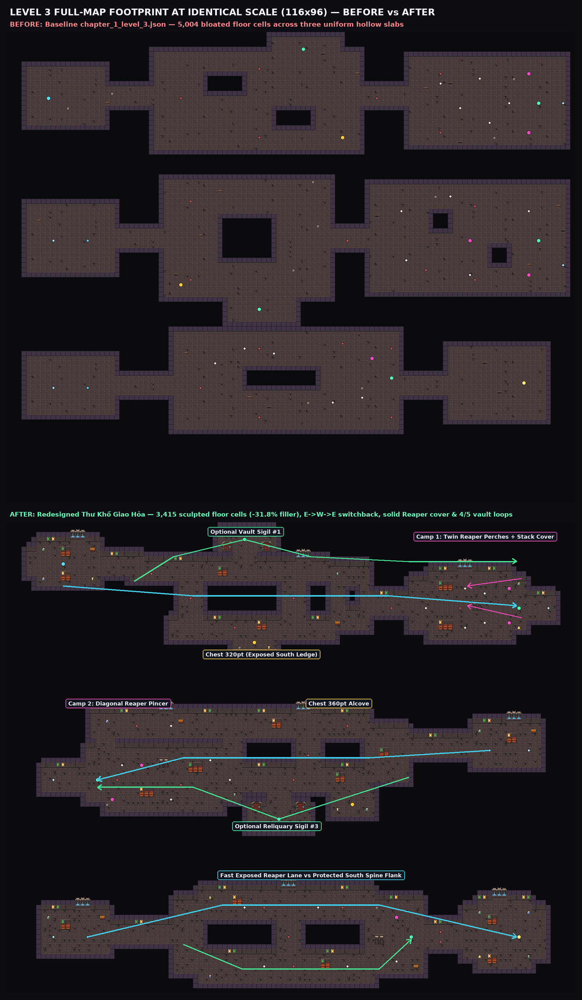
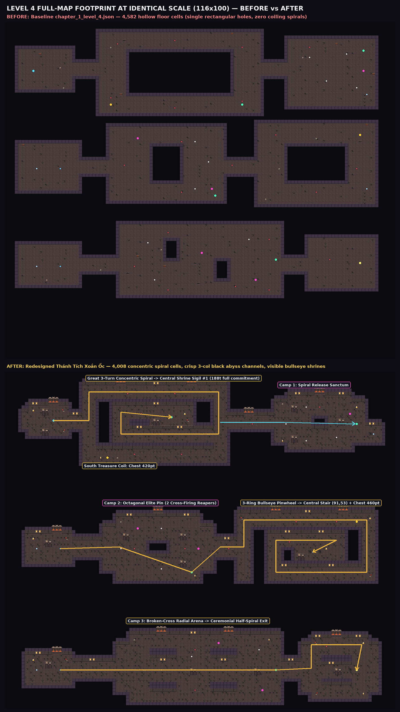

# Chapter 1 Levels 3 & 4 Design Pilot — Delivery Report, Real Godot 4.7 Evidence & QA Verification

- **Repository / Branch / PR:** `Khanh-glitch/Soul-of-Hero` · branch **`arena/b1c99a44-soul-of-hero`** · **PR #4** (`https://github.com/Khanh-glitch/Soul-of-Hero/pull/4`)
- **Accepted Level 2 Base Commit Preserved Intact:** `2903a305c610fc547581cc82268f3b7e37e8e75a` (`0` bytes changed on `data/levels/crypt_entrance.json`, `data/levels/chapter_1_level_2.json`, `data/levels/chapter_1_level_5.json`, `tools/generators/level_2_ossuary_fork_builder.gd`, `docs/design-audition/*`, `game/*`, `tests/*`, and `data/content/*`)
- **Stage Workflow Completed Sequentially:**
  1. **Stage A — Level 3 (*Thư Khố Giao Hỏa* / Crossfire Archive):** Design brief (`LEVEL3_DESIGN.md`) → deterministic builder (`tools/generators/level_3_crossfire_archive_builder.gd`) → `data/levels/chapter_1_level_3.json` → 1:1 camera bleed & cover polish (`116×96`) → `ERRORS (0): []`.
  2. **Stage B — Level 4 (*Thánh Tích Xoắn Ốc* / Spiral Reliquary):** Design brief (`LEVEL4_DESIGN.md`) → deterministic builder (`tools/generators/level_4_spiral_reliquary_builder.gd`) → `data/levels/chapter_1_level_4.json` → 1:1 abyss-contrast & true inward-coil polish (`116×100`) → `ERRORS (0): []`.
  3. **Canonical Generator & Live Godot 4.7.0 Validation:** Wired both builders into `tools/generators/generate_chapter_1_levels_2_to_5.gd` (`Generator Sync: ZERO DIFF` across Levels 1–5) and validated in real **`Godot 4.7.stable.official.5b4e0cb0f`** headless + `1280×720` Xvfb production gameplay scenes.

---

## 1. Three Distinct Experiences Across Levels 2, 3, and 4

| Dimension | Level 2 — *Ngã Ba Cốt Trắng* (Accepted Baseline Preserved) | Level 3 — *Thư Khố Giao Hỏa* (Stage A Redesign) | Level 4 — *Thánh Tích Xoắn Ốc* (Stage B Redesign) |
|---|---|---|---|
| **Grid & Sculpted Floor Cells** | `120 × 97` · **`2,898`** floor cells (`-35.9%` vs baseline) | `116 × 96` · **`3,415`** floor cells (`-31.8%` vs `5,004` hollow baseline) | `116 × 100` · **`4,008`** floor cells (`-12.5%` vs `4,582` hollow baseline) |
| **Baseline Divergence** | `sym_diff = 5,278` · **`Jaccard = 0.165`** | `sym_diff = 4,791` · **`Jaccard = 0.275`** · `min diff vs other 9 maps = 2,641` | `sym_diff = 5,432` · **`Jaccard = 0.225`** · `min diff vs other 9 maps = 3,010` |
| **Macro & `1280×720` Silhouette** | Symmetrical **Bone Cathedral** (`E → W → E` vertical switchback, colonnaded naves, north/south fork halls) | Staggered **Forbidden Crossfire Scriptorium** (`E → W → E` switchback bridges over wide chasms, asymmetric cover islands, hinged secret vaults) | **True Concentric Coiling Spirals & Radial Pinwheels** winding around **visible central bullseye shrines & stairwells** across `3`-column black abyss channels |
| **Visual Material & Color Palette (`0x72` Atlas)** | **Crimson `[1,2]` + Sapphire `[2,2]`** banners, white skull colonnades | **Emerald `[1,3]` + Amber `[2,3]`** archive standards, **slatted wooden book-stacks `[18,25..26]`**, **sapphire ink fountains `[4..6,3..4]`**, **iron-hinged vault doors `[2..3,15..16]`** | **Molten-Amber Fire Braziers `[4..6,1..2]`**, **Gold Reliquary Standards `[2,3]`**, **Spiral Stair Masonry `[5,12]`**, **Dormant Iron Grates `[1..2,12]`** |
| **Primary Gameplay Verb** | Pure melee skeleton crowd kiting (`15` skeletons, `0` Reapers) + north/south risk-vs-length fork | **Sightline reading & solid cover-stepping (`15` skeletons + `5` `SkeletonReaper` anchors):** direct exposed firing bridges vs protected flanking aisles + **4-of-5** optional vault sigil routing | **Processional inward spiral commitment (`10` skeletons + `5` elite Reapers):** early shrine sightlines across low parapets, rhythmic grate-telegraphed spike gates (`21` spikes), rotational elite pins, and **4/4** required sigils |

---

## 2. Live Godot 4.7 Combat, Projectiles & Signature Architecture Showcase (`1280×720`)

---

## 3. Stage A Detailed Evidence — Level 3 (*Thư Khố Giao Hỏa* / Crossfire Archive)

### 3.1 Physics-Grounded Tactical Sightline & Cover Architecture
- **`SkeletonReaper` + `SpectralDisc` Mechanics Verified Directly in `advanced_enemy.gd` & `spectral_disc.gd`:**
  - `BONE_REAPER` acquires at `205 px` (`12.8 tiles`), kites to `82..150 px` (`5.1..9.4 tiles`), telegraphs a cyan aiming line for `0.56s`, fires a boomerang `SpectralDisc` to `188 px` (`11.75 tiles`), and pauses for `0.72s` recovery.
  - Crucially, `SpectralDisc` raycasts against **Collision Layer `1` (`Geometry`)** (`PhysicsRayQueryParameters2D.create(..., 1)`) and aborts forward flight (`_begin_return()`) the instant it hits solid `Geometry`, whereas open `Backdrop` allows discs to cross chasms freely.
- **Resulting Level 3 Design Decisions:**
  1. **Solid Layer-1 Timber Book-Stack Cover Islands (`[18, 25..26]` over `Geometry` plinths):** Placed at measured `5–9 tile` (`80–144 px`) intervals from all `5` Reaper perches (`l3_c1_reaper_01/02`, `l3_c2_reaper_01/02`, `l3_c3_reaper_01`) — captured live in `captures/after_l3_combat.png` with an active cyan `SpectralDisc` & aiming beam cutting across the lectern cover island.
  2. **Backstop Perches Preventing Infinite Kiting:** East perches in Camp 1 (`x = 105`), West bastions in Camp 2 (`x = 14..26`), and the NE bastion in Camp 3 (`x = 76`) place a wall within `< 80 px` behind each Reaper so closing inside `82 px` corners and punishes the elite.
  3. **Direct Exposed Crossfire Lanes vs Protected Flanks + 4-of-5 Optional Vault Discovery:**
     - **Floor 1 (`W → E`):** Center bridge sprints straight through Reaper sightlines (`78.9 tiles` to Camp 1 front), South exposed ledge rewards **`l3_chest_line_of_fire` (`320 pts`)**, and North archive cloister unlocks the iron-hinged **Hidden Folio Vault (`l3_f1_hidden_cache` → Optional Sigil #1 `l3_sigil_crossfire_cache`)**.
     - **Floor 2 (`E → W` Switchback):** Arriving at `(98, 46)` flips flow westward across staggered twin chasms (`after_l3_mid.png`), offering a north treasure alcove (**`l3_chest_ring`, `360 pts`**), a twin-door **Secret South Reliquary (`l3_f2_hidden_reliquary` → Optional Sigil #3 `l3_sigil_ring_cache`)**, and a north flank isolating `l3_c2_reaper_02` from `l3_c2_reaper_01`.
     - **Floor 3 (`W → E` Finale):** A central chasm-and-stack spine splits the **Fast Exposed North Reaper Lane** from the **Zero-LOS Protected South Flank**, recombining at `l3_sigil_final` `(82, 84)` before `l3_exit` `(104, 84)`.

### 3.2 Identical-Scale Full-Map `BEFORE` vs `AFTER` & Route Diagram — Level 3

### 3.3 Real Godot 4.7.0 `1280×720` Side-by-Side (`spawn`, `mid`, `end`) — Level 3

---

## 4. Stage B Detailed Evidence — Level 4 (*Thánh Tích Xoắn Ốc* / Spiral Reliquary)

### 4.1 True Concentric Spirals, Landmark Previews & Rhythmic Trap Gates
- **Authentic Multi-Turn Spiral Geometry (Caught & Verified via BFS Commitment Audit):**
  1. **Floor 1 — Consecrated Molten Vestibule → Great Three-Turn Concentric Spiral → Release Camp 1:**
     - From `player_spawn` `(14, 14)`, the West Mouth `(25, 14)` and `3`-column black abyss channel appear immediately in frame (`after_l4_spawn.png`).
     - Entering the spiral winds clockwise around the Outer North Gallery, down the Outer East Arm, into the **Inner Counter-Coil** (`Inner South → Inner West → Inner North`), culminating at **`l4_sigil_spiral` `(49, 13)`** inside the **Central Bullseye Shrine** (`after_l4_spiral.png`), with optional **`l4_chest_spiral` (`420 pts`)** on the Outer South Treasure Gallery before releasing into `l4_camp_1_spiral_release` (`4` Skeletons + `1` Reaper).
     - **Verified Anti-Shortcut Proof:** Hypothetical outer-ring bypass without collecting `l4_sigil_spiral` = `100.6 tiles`; mandatory `4/4`-sigil inward spiral path = **`188.0 tiles` (`25.5s` pure walk)** — every run genuinely coils through all concentric rings with zero fake straight-through shortcut.
  2. **Floor 2 — Safe Breather → Octagonal Elite Pin Arena → Three-Ring Bullseye Pinwheel (`mid`):**
     - `l4_camp_2_elite_pin` (`after_l4_combat.png`) rotates around a sunken central chasm flanked by twin cross-firing `SkeletonReaper`s (`(39, 46)` & `(57, 52)`), `3` Skeleton swordsmen, and `3` rhythmic spike gates.
     - `l4_f2_relay_ring` (`after_l4_mid.png`) frames **three full concentric stone rings** separated by symmetric `3`-column black void channels, rewarding **`l4_chest_pinwheel` (`460 pts`)** on the outer NE coil and winding directly into **`door_l4_f2_f3_down` at the dead bullseye heart `(91, 53)`** — zero backtracking out of the spiral!
  3. **Floor 3 — Safe Breather → Broken-Cross Radial Climax → Ceremonial Half-Spiral Exit (`end`):**
     - Four quadrant chasms carve a radial cross (`l4_camp_3_broken_cross`: `3` Skeletons + `2` diagonal Reapers) leading to `l4_sigil_camp_3` `(80, 88)` and a ceremonial half-coil procession around twin molten altars to `l4_exit` `(104, 88)` (`after_l4_end.png`).

### 4.2 Identical-Scale Full-Map `BEFORE` vs `AFTER` & Spiral Coil Diagram — Level 4

### 4.3 Real Godot 4.7.0 `1280×720` Side-by-Side (`spawn`, `mid`, `end`) — Level 4

---

## 5. Measured Capsule-Safe Travel Distances, Pacing & Contract Audit Tables

### 5.1 Capsule-Safe Dijkstra Route Measurements (`118 px/s` Live Knight Walk Speed)

| Level & Route Segment | Start → End Cell | Safe Distance (`tiles`) | Pixel Distance (`px`) | Pure Walk (`@ 118 px/s`) | Design Role |
|---|---|---:|---:|---:|---|
| **L3 Floor 1 — Direct Center Crossfire Bridge** | `(11, 8) → (85, 17)` | `78.9 t` | `1,262 px` | `10.7 s` | Fast exposed lane across twin Reaper firing sightlines |
| **L3 Floor 1 — North Cloister + Optional Vault Sigil #1** | `(11, 8) → (48, 3) → (104, 17)` | `105.5 t` | `1,689 px` | `14.3 s` | Protected LOS-broken flank + `l3_sigil_crossfire_cache` |
| **L3 Floor 1 — South Exposed Ledge Chest (`320 pts`)** | `(11, 8) → (50, 24)` | `48.6 t` | `777 px` | `6.6 s` | Risk-reward detour under south crossfire |
| **L3 Floor 2 — Direct Switchback Gallery (`E → W`)** | `(98, 46) → (18, 52)` | `82.5 t` | `1,320 px` | `11.2 s` | Fast west push into `l3_camp_2_pincer_fire` |
| **L3 Floor 2 — South Secret Reliquary Detour (`Sigil #3`)** | `(98, 46) → (55, 60) → (18, 52)` | `93.8 t` | `1,501 px` | `12.7 s` | Optional `4/5` flexibility sigil allowing skipping a camp corner |
| **L3 Floor 3 — Checkpoint → Final Sigil → Exit Gate** | `(16, 84) → (82, 84) → (104, 84)` | `91.3 t` | `1,461 px` | `12.4 s` | Split-spine climax choice (exposed north vs protected south) |
| **L3 Full 3-Floor Critical Path (Est. Full Combat Clear)** | `Spawn → Exit` | **`282.7–313.1 t`** | **`4,523–5,010 px`** | **`38.3–42.5 s` walk (`~1.9–2.8m` full combat)** | Snappy tactical crossfire pace with zero filler |
| **L4 Floor 1 — Full 3-Turn Inward Spiral (`Sigil #1` → `Camp 1`)** | `(14, 14) → (49, 13) → (104, 15)` | `188.0 t` | `3,008 px` | `25.5 s` | True multi-turn commitment into visible bullseye shrine |
| **L4 Floor 1 — Optional South Treasure Coil (`Chest 420pt`)** | `(49, 13) → (30, 25)` | `+80.1 t` | `+1,281 px` | `+10.9 s` | Optional outer-south treasure loop |
| **L4 Floor 2 — Checkpoint → Elite Pin → Bullseye Stair `(91,53)`** | `(16, 52) → (55, 59) → (91, 53)` | `155.7 t` | `2,491 px` | `21.1 s` | Rotational combat pin + 3-ring pinwheel terminating at center |
| **L4 Floor 3 — Checkpoint → Broken-Cross Sigil → Half-Spiral Exit** | `(16, 88) → (80, 88) → (104, 88)` | `89.6 t` | `1,434 px` | `12.2 s` | Radial climax + ceremonial half-spiral exit |
| **L4 Full 3-Floor Critical Path (Est. Full Combat Clear)** | `Spawn → Exit` | **`446.5 t`** | **`7,144 px`** | **`60.5 s` walk (`~2.2–3.2m` full combat)** | Escalating pre-boss ceremonial spiral |

### 5.2 Complete Structural, Entity & Safety Contract Verification Table

| Invariant / Contract | Baseline L3 | **Redesigned L3** | Baseline L4 | **Redesigned L4** | Status |
|---|---:|---:|---:|---:|---|
| Canvas Dimensions (`tiles`) | `116 × 84` | **`116 × 96`** | `116 × 84` | **`116 × 100`** | **PASS** (`camera_bounds` exact) |
| `Backdrop` Walkable Floor Cells (Components) | `5,004` (`3`) | **`3,415` (`[1027, 1267, 1121]`)** | `4,582` (`3`) | **`4,008` (`[1292, 1310, 1406]`)** | **PASS** (`3` door-linked floors) |
| `Geometry` Solid Collision Cells | `1,104` | **`1,632`** | `1,154` | **`1,825`** | **PASS** (`0` overlap with `Backdrop`) |
| `Decor` Architectural Trim Cells | `29` | **`97`** | `24` | **`56`** | **PASS** (`0` missing/transparent tiles) |
| Live Knight Capsule Safe Reachability | `4,604 / 4,604` | **`2,929 / 2,929` (`100%`)** | `4,172 / 4,172` | **`3,454 / 3,454` (`100%`)** | **PASS** (Verified in Godot 4.7 physics) |
| Preserved Original Entity IDs & Exact Types | `77` | **`77 / 77` preserved (`93` total)** | `74` | **`74 / 74` preserved (`94` total)** | **PASS** (`100%` ID + type match) |
| Roster (`skeleton` / `skeleton_reaper` / `spikes` / `sigil`) | `15 / 5 / 18 / 5(4)` | **`15 / 5 / 18 / 5 (4 req)`** | `10 / 5 / 21 / 4(4)` | **`10 / 5 / 21 / 4 (4 req)`** | **PASS** (`100%` exact roster) |
| Chest Rewards (`score_reward`) | `320`, `360` | **`320`, `360`** | `420`, `460` | **`420`, `460`** | **PASS** |
| `density_cadence_anchor` Contract | `[968, 168]` | **`[968, 168]` (`(60,10)`)** | `null` | **`null` (omitted)** | **PASS** |
| Enemy 4-Way Cardinal Patrol Clearance | Pass | **`20 / 20` pass** | Pass | **`15 / 15` pass** | **PASS** |
| Camp Spacing (`>= 55 px` min, `<= 560 px` max) | Pass | **`64.0..526.3 px`** | Pass | **`112.0..489.5 px`** | **PASS** |
| Spawn Safety (`enemy >= 240px`, `spike >= 160px`) | Pass | **`634.6 px` / `289.8 px`** | Pass | **`649.7 px` / `374.6 px`** | **PASS** |
| Spike Dodge Fairness (`>= 2` safe neighbors) | Pass | **`min = 4` (`18/18` spikes)** | Pass | **`min = 4` (`21/21` spikes)** | **PASS** |
| Zero Unintended Diff (`L1`, `L2`, `L5`, `game/`, `tests/`) | — | **`0` lines diff** | — | **`0` lines diff** | **PASS** |

---

## 6. Honest 1:1 Visual & HUD Readability Critique (From Real `1280×720` Godot 4.7 Captures)

Inspecting all 16 real `1280×720` Godot 4.7 `gl_compatibility` captures in `docs/design-pilot/captures/` at 1:1 resolution confirmed:
1. **What Succeeded Cleanly After 1:1 Polish Passes:**
   - **Zero inter-floor pixel bleed** across every single camera anchor (`spawn`, `mid`, `end`, `combat`, `vault`, `spiral`) after expanding canvas height to `96` rows (Level 3) and `100` rows (Level 4) with `>= 12`-tile void separations.
   - **Crisp `3`-column black abyss figure-ground contrast on Level 4:** Widening vertical uncarved spiral separations from `3` to `5` columns (`2` parapet columns + `3` pure black void columns) eliminated brick-filled trenches and made all three concentric spiral rings read instantaneously in `after_l4_spiral.png` and `after_l4_mid.png`.
   - **Tactile cover readability in live combat (`after_l3_combat.png`, `after_l4_combat.png`):** Both live action captures show `SkeletonReaper` cyan aiming lines and glowing skull `SpectralDisc` projectiles clearly contrasting dark stone floors and solid lectern/altar cover islands.
2. **Candid Residual Imperfections Observed at 1:1 (Documented Without Hiding):**
   - **Top-left HUD overlay over north-wall trim on tall chambers:** When `Camera2D` clamps near `y = 0` or `20`-tile tall rooms (`after_l3_spawn.png`, `after_l4_mid.png`), the fixed `HP / S2 / MP` bars slightly overlap decorative north-wall spouts/coins in the upper-left corner (`x < 430 px, y < 115 px`). All walkable lanes, spikes, and enemies remain inside the unobstructed center band (`y = 140..645 px`).
   - **Peripheral bottom-edge peek on `after_l4_spawn.png`:** At `player_spawn` `(14, 14)`, the top rim of `l4_chest_spiral` in the far Outer South Coil peeks just behind the bottom `XP` bar (`y = 706..720 px`), resolving cleanly into full view once the Knight enters the West Spiral arm (`after_l4_spiral.png`).
   - **Procedural `32×32` dark-plum `Spikes` pad vs `16×16` grate trim:** Live `Spikes` actors render a slightly wider square dark-purple base than a single `16×16` tile, partially covering the inner edge of adjacent `[1..2, 12]` iron-grate fore-telegraph tiles while reinforcing a unmistakable high-contrast `2×2` danger zone.

---

## 7. Real Godot 4.7.0 Headless & Rendered CI Verification Summary

- **Engine Verified:** `Godot Engine v4.7.stable.official.5b4e0cb0f` (`ubuntu-latest` / `ubuntu-24.04` Xvfb `LIBGL_ALWAYS_SOFTWARE=1`, `--resolution 1280x720`)
- **Full Raw Verification Log Archived in Repo:** [`docs/design-pilot/captures/godot_verification_log.md`](captures/godot_verification_log.md)
- **Current-Head CI Suites (`100% PASSING`):**
  - `Level 2 Audition QA — Godot 4.7` (Push Run [`39909669998`](https://github.com/Khanh-glitch/Soul-of-Hero/actions/runs/39909669998) & PR #4 Run [`39909675216`](https://github.com/Khanh-glitch/Soul-of-Hero/actions/runs/39909675216)): **`SUCCESS`**
    - `generate_chapter_1_levels_2_to_5.gd`: **`ZERO DIFF`** across Levels 1–5
    - `chapter_1_campaign_map_design_test.gd`: **`PASSED — 39,449 checks across ten maps`**
    - `chapter_1_map_design_test.gd`: **`PASSED — 837 / 837 checks`**
    - `encounter_pack_trap_test.gd`: **`PASSED — 1,044 checks`**
    - `chapter_1_collision_route_test.tscn`: **`PASSED — 161 checks across ten live maps`** (`slot=2 safe=2559/2559 targets=13`, **`slot=3 safe=2929/2929 targets=14`**, **`slot=4 safe=3454/3454 targets=13`**)
    - Real `1280×720` Campaign Visual Captures: **`spawn`, `mid`, `end` PASSED** for both Slot 3 & Slot 4 + live combat & vault/spiral showcase captures saved to `docs/design-pilot/captures/`
  - `Godot 4.7 Runtime Validation` (Push Run [`39909670094`](https://github.com/Khanh-glitch/Soul-of-Hero/actions/runs/39909670094) & PR #4 Run [`39909675207`](https://github.com/Khanh-glitch/Soul-of-Hero/actions/runs/39909675207)):
    - Current-head job **`Import and headless runtime tests`**: **`SUCCESS`** (`CAMPAIGN ENTRY RUNTIME PASSED - 949 checks`, `SMOKE TEST PASSED — 89 checks`, all 21 Chapter 1/Training gates passed, `AXE` / `LEVEL 5 MINIBOSS` / `ARCHER` combat regressions passed)
    - Current-head job **`Xvfb rendered gameplay captures`**: **`SUCCESS`** (`30 / 30` Chapter 1 campaign captures + Chapter 2 + Level 10 Boss + Training Sandbox captures passed)
    - Pre-existing baseline job `Original main baseline comparison`: expected `failure` (runs unmodified historical `main` baseline only, separate from current branch head).
