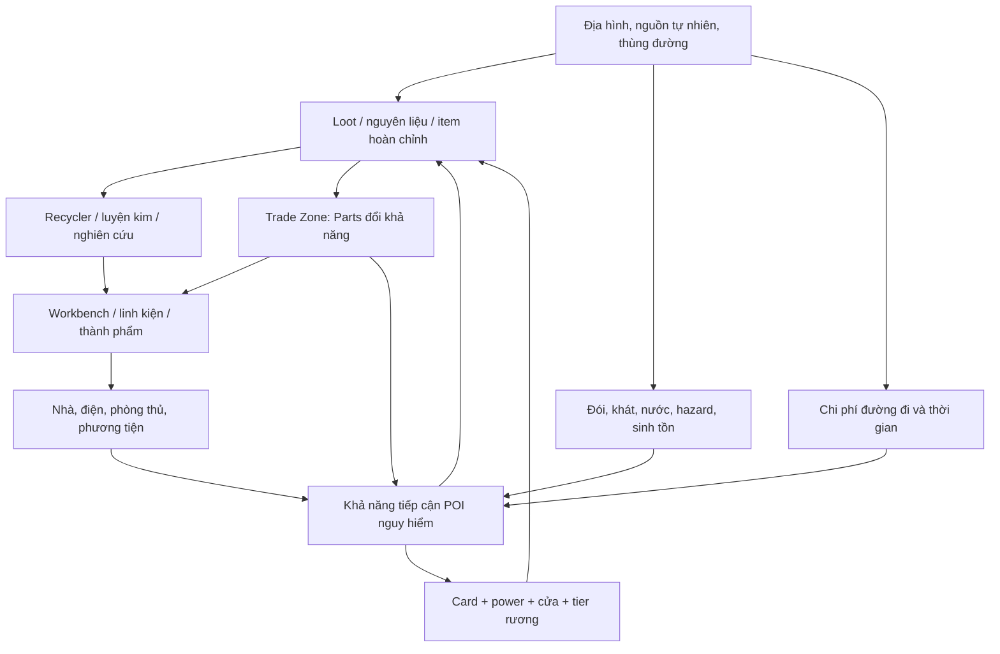

# LAST ISLAND — MASTER MECHANICAL SYSTEMS ATLAS

> Bản hợp nhất nghiên cứu v1–v4 và bổ sung đối chiếu nguồn ngày 04/11/2026. **Chỉ Last Island; chưa thực hiện bất kỳ đối chiếu SOH nào.**

## 1. Đối tượng, phương pháp và ranh giới

Nghiên cứu truy vết hai chiều: **nguồn loot / công cụ / nguyên liệu → công đoạn → thành phẩm → công dụng**, đồng thời **mục tiêu → điều kiện mở khóa → vật liệu → nguồn/địa điểm → rủi ro/thời gian**. Mỗi thay đổi chế độ/phiên bản được giữ làm thuộc tính, không xem là lý do để bỏ dữ liệu.

Cột *quan sát/luật nguồn* là điều tài liệu thực sự mô tả; cột *lựa chọn sinh ra* là suy luận cấu trúc. Không đặt ngẫu nhiên tỷ lệ hoặc hệ số thiếu.

**Cơ sở dữ liệu hợp nhất:** 18 họ hệ thống, 51 recipe, 82 quan hệ loot, 19 đường truy cập, 37 giá, 6 phép đo trực tiếp, 437 cạnh đồ thị có kiểu, 405 dòng đối chiếu 1–1 trống phía SOH.

## 2. Bản đồ vĩ mô: hệ thống phụ thuộc hệ thống

## 3. 18 chương chuyên môn: luật → hành động → kết quả → quyết định

### S01 — Harvesting, material and tool tiers

**Trạng thái/biến đầu vào:** Tool category, tool grade, strike count, durability, node stock, node rarity.

**Hành động:** Select tool; strike natural source; gather until depleted.

**Đầu ra vật lý/trạng thái:** Wood/ore/sulfur/resources and tool wear.

**Suy luận về lựa chọn người chơi:** Tool grade changes effort and opportunity cost, not necessarily total node yield.

**Chỉ tiêu truy vết khi đối chiếu:** Different tools / same node / compare hits+stock+wear.

**Ghi chú atlas v4:** Stone → Iron → Refined Iron tools gather wood & ore; durability and loot alternatives. Need harvest per swing and node output rates.

- Nguồn `s_axe`: https://www.9game.cn/daihaoyingxiong/4515476.html
- Nguồn `s_ironaxe`: https://www.aspxhome.com/youxi/2023/397622.htm
- Nguồn `coldfacts_2019`: https://www.taptap.cn/moment/15218919606324324

### S02 — Ore, metallurgy and fuel

**Trạng thái/biến đầu vào:** Ore class, fuel type, furnace tier, input stack, refined-ore rarity.

**Hành động:** Mine ore; fuel furnace; smelt batches.

**Đầu ra vật lý/trạng thái:** Iron/refined ingots, by-products and retained fuel.

**Suy luận về lựa chọn người chơi:** Ore throughput, parallel furnace batches and rare refined feedstock compete with wood.

**Chỉ tiêu truy vết khi đối chiếu:** Same ore batch / same fuel / compare yield, time and residual.

**Ghi chú atlas v4:** Ore → furnace → standard / refined ingots; parallel furnaces multiply throughput; tools may affect refined-ore frequency.

- Nguồn `s_motor`: https://www.9game.cn/news/3676549.html
- Nguồn `foldladder_2019`: https://www.9game.cn/news/3442605.html
- Nguồn `coldfacts_2019`: https://www.taptap.cn/moment/15218919606324324

### S03 — Recycler and material recovery

**Trạng thái/biến đầu vào:** Input identity, source, disassembly table, output Part/refined-iron class.

**Hành động:** Loot spare gear/pipe/blade; recycle or keep.

**Đầu ra vật lý/trạng thái:** Parts and possibly recovered metal.

**Suy luận về lựa chọn người chơi:** Disassembly bypasses dedicated mining, but forfeits useful component.

**Chỉ tiêu truy vết khi đối chiếu:** Same input / record exact Parts and metallic outputs.

**Ghi chú atlas v4:** Roadside barrels / spare appliances / blades → recycler at named POI → Parts; exact yield-per-item unresolved.

- Nguồn `loot_2019`: https://www.9game.cn/daihaoyingxiong/3467983.html
- Nguồn `s_recycler`: https://news.4399.com/zhytgz/xinde/m/895633.html

### S04 — Knowledge, blueprints and research

**Trạng thái/biến đầu vào:** Item known status, station, input specimen, Parts, blueprint and category exclusions.

**Hành động:** Study item, roll recipe, draw/copy, spend Parts.

**Đầu ra vật lý/trạng thái:** Durable learned craft right, sometimes physical drawing.

**Suy luận về lựa chọn người chơi:** Used/rare item has competing use, study, recycle and trade value.

**Chỉ tiêu truy vết khi đối chiếu:** One rare item: use versus study versus dismantle.

**Ghi chú atlas v4:** Parts compete among random research, copying a consumed original, bench upgrades and components.

- Nguồn `qa_2019`: https://news.4399.com/zhytgz/zixun/m/895413.html
- Nguồn `drawing_2019`: https://www.9game.cn/news/3786502.html
- Nguồn `research_2021`: https://hero.yingxiong.com/m/info/2021/0825/6977.html

### S05 — Workstation tier and production queue

**Trạng thái/biến đầu vào:** Bench tiers 1–3, learned recipe, queue state, materials, work timer.

**Hành động:** Upgrade bench, reserve inputs, craft, leave station.

**Đầu ra vật lý/trạng thái:** Intermediate/finished physical products.

**Suy luận về lựa chọn người chơi:** Knowledge and production capability are separate gates.

**Chỉ tiêu truy vết khi đối chiếu:** Craft same item with known recipe but insufficient bench.

**Ghi chú atlas v4:** Bench tier gates production independently of physical item, acquired knowledge and material access.

- Nguồn `weapon_cookbook_2020`: https://www.dlyybbs.com/t28
- Nguồn `qa_2019`: https://news.4399.com/zhytgz/zixun/m/895413.html

### S06 — Loot container taxonomy and tiers

**Trạng thái/biến đầu vào:** Container family, tier, location, guaranteed category, per-item chance.

**Hành động:** Choose route, destroy/open container, secure contents.

**Đầu ra vật lý/trạng thái:** Distinct categories of tools, food, guns, components, kits.

**Suy luận về lựa chọn người chơi:** Loot meaning comes from expected capability not just amount.

**Chỉ tiêu truy vết khi đối chiếu:** Open fixed category×tier sample; tally per-item frequency.

**Ghi chú atlas v4:** Colored barrels, Toolbox, Supply, Military, High Military, Airdrop; loot can bypass long crafting branches.

- Nguồn `official_weapons_2019`: https://hero.yingxiong.com/info/2019/0927/7249.html
- Nguồn `s_loot`: https://shouyou.3dmgame.com/gl/133819.html

### S07 — POI card/power/access ladder

**Trạng thái/biến đầu vào:** Card color, charges, door power, generator resistor, site enemy/hazard and exit.

**Hành động:** Scout, obtain cards, supply electricity, open room, retreat.

**Đầu ra vật lý/trạng thái:** Better rooms and higher-tier material pools.

**Suy luận về lựa chọn người chơi:** Cards, power, hazard, travel and respawn act as orthogonal gates.

**Chỉ tiêu truy vết khi đối chiếu:** Approach POI with and without each input; record time and expenditure.

**Ghi chú atlas v4:** Green → Blue → Purple access with independent power, spatial placement and risk; non-POI damaged-box bypass.

- Nguồn `official_poi_2019`: https://hero.yingxiong.com/info/2019/0807/7028.html
- Nguồn `pois_2020`: https://game.xiaomi.com/viewpoint/1127866428_1601132863008_16

### S08 — Electrical circuits and automation

**Trạng thái/biến đầu vào:** Generator, power source, wire, switches, pressure sensor, infrared sensor, receiver.

**Hành động:** Wire conditional circuits, turn electricity on/off.

**Đầu ra vật lý/trạng thái:** Door opens, trap activates, light/turret receives power.

**Suy luận về lựa chọn người chơi:** Topology of switches can make new player-designed logic.

**Chỉ tiêu truy vết khi đối chiếu:** Same device on direct feed versus conditional trigger.

**Ghi chú atlas v4:** Generator + fuel → manual / pressure / infrared switch → powered electric door or industrial light; can create traps.

- Nguồn `house_2019`: https://www.9game.cn/daihaoyingxiong/3660151.html
- Nguồn `s_door`: https://www.9game.cn/news/3336352.html

### S09 — Base building, support and maintenance

**Trạng thái/biến đầu vào:** Foundation geometry/count, support graph, doors/walls HP, cabinet and upkeep.

**Hành động:** Place modules, add support, supply materials, repair structures.

**Đầu ra vật lý/trạng thái:** Secure shelter, storage, new buildable volume.

**Suy luận về lựa chọn người chơi:** More area is not always better: support, exposure and upkeep rise.

**Chỉ tiêu truy vết khi đối chiếu:** Same materials build A/B footprints then compare upkeep/defense.

**Ghi chú atlas v4:** Square/triangle foundations, stairs, wall support, low-HP doors, storage and upkeep scaling by foundation count.

- Nguồn `house_2019`: https://www.9game.cn/daihaoyingxiong/3660151.html
- Nguồn `qa_2019`: https://news.4399.com/zhytgz/zixun/m/895413.html

### S10 — Turrets, traps and active defense

**Trạng thái/biến đầu vào:** Turret ammo/target/power, trap type, activation and placement.

**Hành động:** Position device, supply ammo or power, trigger enemy.

**Đầu ra vật lý/trạng thái:** Damage, warning, denial of approach.

**Suy luận về lựa chọn người chơi:** Defensive layout is a resource allocation system.

**Chỉ tiêu truy vết khi đối chiếu:** Same incoming route and material budget compare outcomes.

**Ghi chú atlas v4:** Turret types differ precision/rate/damage; traps need ammo or rearm, danger from placement and targeting.

- Nguồn `house_2019`: https://www.9game.cn/daihaoyingxiong/3660151.html
- Nguồn `ammo_2019`: https://www.9game.cn/daihaoyingxiong/3279791.html
- Nguồn `trap_2019`: https://www.onlinedown.net/article/10012371.htm

### S11 — Vehicles, frame and physical transport

**Trạng thái/biến đầu vào:** Frame, gear, plate, refined metal, fuel, passengers, drive stamina, loading.

**Hành động:** Craft/loot vehicle; load, move, repair, drive.

**Đầu ra vật lý/trạng thái:** Cargo throughput, reach, access to distant POI.

**Suy luận về lựa chọn người chơi:** Transport is a second-tier economic multiplier, not just speed.

**Chỉ tiêu truy vết khi đối chiếu:** Same expedition with/without vehicle, track total usable haul.

**Ghi chú atlas v4:** Motorcycle Frame × Gear × Plate; alternative loot/acquisition of entire intermediate parts; 28-day-world spawn detail.

- Nguồn `s_motor`: https://www.9game.cn/news/3676549.html
- Nguồn `source_forge_2019`: https://www.9game.cn/news/3676549.html
- Nguồn `qa_2019`: https://news.4399.com/zhytgz/zixun/m/895413.html

### S12 — Oil barrel and energy fuel chain

**Trạng thái/biến đầu vào:** Red barrels, crude oil, animal fat, cloth, low-grade fuel, refinery.

**Hành động:** Collect oil/fat, process fuel, feed generator/vehicle.

**Đầu ra vật lý/trạng thái:** Usable fuel and power duration.

**Suy luận về lựa chọn người chơi:** Fuel competes with production and movement; geography matters.

**Chỉ tiêu truy vết khi đối chiếu:** Measure input→fuel→power/drive minutes.

**Ghi chú atlas v4:** Oil barrel → crude oil / low-grade fuel; animal fat + cloth, oil refinery; fuel to generator/transport.

- Nguồn `s_fuel`: https://www.9game.cn/news/3448709.html
- Nguồn `s_refinery`: https://www.9game.cn/news/3448709.html
- Nguồn `house_2019`: https://www.9game.cn/daihaoyingxiong/3660151.html

### S13 — Food, water, medical and exposure

**Trạng thái/biến đầu vào:** Hunger, thirst, food, fresh/salt water, container charges, radiation, meds.

**Hành động:** Forage, cook, drink, treat, collect dew, filter/avoid hazard.

**Đầu ra vật lý/trạng thái:** Survival time, HP, access to hazardous POI.

**Suy luận về lựa chọn người chơi:** Needs compete with exploration time and industrial crafting.

**Chỉ tiêu truy vết khi đối chiếu:** Same route under different supplies, quantify reserves.

**Ghi chú atlas v4:** Wild forage → cloth / tin / meat / mushrooms → healing and preparedness; medical chain bandage→syringe→medkit.

- Nguồn `food_2019`: https://www.9game.cn/news/3416705.html
- Nguồn `med_2025`: https://www.9game.cn/news/10769547.html
- Nguồn bổ sung `M5-OFFICIAL-WATER-2020`: https://hero.yingxiong.com/info/2020/0429/9792.html

### S14 — Biome and risk-linked sourcing

**Trạng thái/biến đầu vào:** Biome class, ore prevalence, radiation, masked traversal, creature locations.

**Hành động:** Choose mining or route to POI, equip protection.

**Đầu ra vật lý/trạng thái:** Different node mix and accessible loot.

**Suy luận về lựa chọn người chơi:** A spatial source grid makes travel/risk part of technology.

**Chỉ tiêu truy vết khi đối chiếu:** Compare safe and dangerous regions per usable haul.

**Ghi chú atlas v4:** Snow increases ore; desert sulfur; forest foraging; nuclear / card POI hazard; map route choices.

- Nguồn `coldfacts_2019`: https://www.taptap.cn/moment/15218919606324324
- Nguồn `official_poi_2019`: https://hero.yingxiong.com/info/2019/0807/7028.html

### S15 — Time, death, offline and run cycle

**Trạng thái/biến đầu vào:** Real-world run clock, death drop, respawn, sleep point, off-line player exposure.

**Hành động:** Logout, maintain shelter, recover bag, survive to endgame.

**Đầu ra vật lý/trạng thái:** Run survival and retained knowledge/status where supported.

**Suy luận về lựa chọn người chơi:** Time pressure changes maintenance, risk and investment horizon.

**Chỉ tiêu truy vết khi đối chiếu:** Replay sequence of off/on/death/end across multiple conditions.

**Ghi chú atlas v4:** 15 real days; different mode windows; when logged out character persists; full death drop but learned blueprint survives in that described mode.

- Nguồn `qa_2019`: https://news.4399.com/zhytgz/zixun/m/895413.html
- Nguồn bổ sung `M5-OFFICIAL-ENDGAME-2020`: https://hero.yingxiong.com/info/2020/0429/9792.html

### S16 — Airdrop, timed world event and scarcity

**Trạng thái/biến đầu vào:** Drop schedule, spawn location, unlock delay, arrival risk, finite loot.

**Hành động:** Observe event, decide contest/route, extract reward.

**Đầu ra vật lý/trạng thái:** High-tier equipment, rare blueprints, industrial bypasses.

**Suy luận về lựa chọn người chơi:** Timed events interrupt plans and give geography temporal value.

**Chỉ tiêu truy vết khi đối chiếu:** Compare early vs late response and net retained reward.

**Ghi chú atlas v4:** Six-hour world airdrop at named high-value locations, visible global marker; 10 minute unlock after landing, high-tier gear.

- Nguồn `official_weapons_2019`: https://hero.yingxiong.com/info/2019/0927/7249.html

### S17 — Specialized energy extraction

**Trạng thái/biến đầu vào:** Special extractor, advanced bench, special ore, refiner and energy output.

**Hành động:** Find blueprint, assemble machinery, reach blue ore, refine.

**Đầu ra vật lý/trạng thái:** Special energy materials and equipment capabilities.

**Suy luận về lựa chọn người chơi:** Access to new resource class is a functional technology tier.

**Chỉ tiêu truy vết khi đối chiếu:** Verify basic pick fails, extractor succeeds, refiner processes.

**Ghi chú atlas v4:** Blue energy ore requires specialized extraction device and refinement station; tier 3 bench, level gate.

- Nguồn `energy_2021`: https://www.biubiu001.com/wpzzwmcq/38708.html
- Nguồn bổ sung `M5-ENERGY-2021`: https://www.biubiu001.com/wpzzwmcq/38708.html

### S18 — Player market and multiple acquisition paths

**Trạng thái/biến đầu vào:** Parts price, stock, restock timer, day-gated stock, alternative recipes.

**Hành động:** Buy, loot, craft, study, recycle for same target item.

**Đầu ra vật lý/trạng thái:** Capabilities acquired via distinct costs.

**Suy luận về lựa chọn người chơi:** Price creates opportunity costs versus risky POI or production.

**Chỉ tiêu truy vết khi đối chiếu:** Compare 3 legal acquisition paths to same capability.

**Ghi chú atlas v4:** Bổ sung từ nguồn mới.

- Nguồn bổ sung `M5-TRADE-2022`: https://game.xiaomi.com/viewpoint/1433291088_1650964079570_100

## 4. Deep-dive: 8 mạng nhân quả cần giữ nguyên tính liên kết

### D01 — Thùng đường → bộ phận máy → Recycler → Parts → nghiên cứu hoặc mua đồ

Loại thùng quyết định nhóm hàng có thể rơi. Gear, Pipe và Blade có giá trị như bán thành phẩm và như nguồn phân giải; Parts có thể chi cho blueprint, nâng cấp Workbench, linh kiện hoặc mua trực tiếp tại Trade Zone. **Tỷ lệ phân giải từng item và tỷ lệ thùng rơi chưa có bảng đầy đủ**, vì vậy không tính ROI tưởng tượng.

### D02 — Mỏ → Furnace → Refined Iron → Pipe/Gear/Plate → công trình cao cấp

Các công thức về Iron/Refined Iron/Parts có thể khai triển từ thành phẩm xuống lá nguyên liệu trong `LI_RECIPES.csv`. Ví dụ Electric Door khi tự chế Gear+10 Plate có 100 Iron Ingots, 50 Refined Iron Ingots, 365 Parts và 5 Electronic Parts; chỉ tính nguyên liệu đóng trong đồ thị, không cộng fuel, workbench, dây.

### D03 — Ba cấp rìu → lượt đánh → thời gian → nguồn phục hồi

Dữ liệu Action Base ghi 6/5/4 hits với mỏ sắt/sulfur khi dùng Stone/Iron/Refined Axe; tổng sắt nhận khoảng 271–274 (cùng 2 rare ore). Đây là cơ chế tiết kiệm công sức, không phải hệ số nhân tổng sản lượng. Cần đo time-per-swing, durability và công thức payback.

### D04 — Card → điện → cửa → chest class+tier → card cấp sau

Một POI cần đúng thẻ, số charge còn, nguồn resistor/điện, hình học đường vào và đường thoát. Rương có hai chiều cấu trúc: loại (supply/tool/military/food/medical/harpoon) và cấp (damaged/low/mid/high); 2022 official công bố Green/Blue/Purple 6/6/7 rương và thành phần chính xác. Những nguồn 2019 có khác biệt POI không làm mất hợp đồng hai chiều của nguồn 2022.

### D05 — Electric Door không thể tách khỏi năng lượng và điều khiển

Door + Generator + Switch/pressure/infrared có các recipe con. Đây là hệ mạch, không chỉ chi phí item. Mô hình cần topology, nhiên liệu, kích hoạt, timer và user-designed trigger; số watt/phút chưa được đưa từ những nguồn được xác nhận.

### D06 — Nhà: nền và support ảnh hưởng cả HP, chi phí và quy hoạch

Foundation, walls, doors và stairs ảnh hưởng không gian và độ chống chịu; territory/cabinet thêm chi phí bảo trì tăng theo số nền. Cần giữ đơn vị/ngưỡng cụ thể của từng bản, không biến % phụ phí thành số vật liệu tuyệt đối.

### D07 — Xe: BOM khổng lồ nhưng có thể vượt cấp bằng loot

Motorcycle sử dụng Refined Iron + Frame + Gear + Plate; raw BOM (theo sản lượng 1/batch) rất lớn. Giá trị thực của một Gear nhặt được bao gồm thời gian tiết kiệm việc sản xuất, không chỉ giá nguyên liệu. Xe sau đó thay đổi vòng đi loot, đường, nhiên liệu.

### D08 — Nước ngọt, nước biển, Collector và thực phẩm

Official 2020 quy định uống nước mặn làm mất thirst, nước ngọt hồi thirst; hoạt động tăng tiêu hao; canteen mang nước, dew collector tích nước định kỳ; thức ăn tương tác với cả đói/khát. Đây là một hệ nguồn–đầu ra–vận tải nhỏ tự đủ, không phải thanh thirst độc lập.

## 5. Các công thức và BOM khai triển (có giả định sản lượng một thành phẩm)

| ID | Trạm | Nguyên liệu trực tiếp | Nguyên liệu lá khi tự chế | Nguồn |
|---|---:|---|---|---|
| `metal_blade` | L2 | 30×iron_ingot, 15×parts | 30×iron_ingot, 15×parts | s_blade |
| `metal_pipe` | L2 | 5×refined_iron_ingot, 30×parts | 30×parts, 5×refined_iron_ingot | s_pipe |
| `torsion_spring` | L2 | 5×refined_iron_ingot, 65×parts | 65×parts, 5×refined_iron_ingot | s_spring |
| `mechanical_gear` | L2 | 50×iron_ingot, 65×parts | 50×iron_ingot, 65×parts | s_gear |
| `iron_plate` | L2 | 5×refined_iron_ingot, 30×parts | 30×parts, 5×refined_iron_ingot | s_plate |
| `vehicle_frame` | L3 | 100×iron_ingot, 30×refined_iron_ingot, 50×parts | 100×iron_ingot, 50×parts, 30×refined_iron_ingot | s_frame |
| `iron_axe` | L1 | 75×iron_ingot, 100×wood | 75×iron_ingot, 100×wood | s_ironaxe |
| `refined_iron_axe` | L2 | 2×refined_iron_ingot, 5×metal_blade, 1×metal_pipe | 150×iron_ingot, 105×parts, 7×refined_iron_ingot | s_axe |
| `machete` | L2 | 100×iron_ingot, 3×metal_blade | 190×iron_ingot, 45×parts | s_machete |
| `semi_auto_rifle` | L2 | 450×iron_ingot, 30×refined_iron_ingot, 2×torsion_spring | 450×iron_ingot, 130×parts, 40×refined_iron_ingot | s_rifle |
| `rocket_launcher` | L3 | 50×refined_iron_ingot, 6×metal_pipe, 5×torsion_spring, 1×launcher_mechanism | 1×launcher_mechanism, 505×parts, 105×refined_iron_ingot | s_rocket |
| `electric_door` | L3 | 50×iron_ingot, 5×electronic_parts, 1×mechanical_gear, 10×iron_plate | 5×electronic_parts, 100×iron_ingot, 365×parts, 50×refined_iron_ingot | s_door |
| `fuel_generator` | L3 | 20×refined_iron_ingot, 100×iron_ingot, 30×electronic_parts, 100×parts | 30×electronic_parts, 100×iron_ingot, 100×parts, 20×refined_iron_ingot | s_door |
| `switch` | L3 | 10×iron_ingot, 2×electronic_parts, 10×parts | 2×electronic_parts, 10×iron_ingot, 10×parts | s_door |
| `pressure_switch` | L3 | 50×iron_ingot, 15×parts, 10×electronic_parts, 2×iron_plate | 10×electronic_parts, 50×iron_ingot, 75×parts, 10×refined_iron_ingot | s_door |
| `infrared_switch` | L3 | 30×iron_ingot, 10×electronic_parts, 15×parts | 10×electronic_parts, 30×iron_ingot, 15×parts | s_door |
| `motorcycle` | L3 | 200×refined_iron_ingot, 1×vehicle_frame, 30×mechanical_gear, 30×iron_plate | 1600×iron_ingot, 2900×parts, 380×refined_iron_ingot | s_motor |
| `oil_refinery` | L3 | 500×iron_ingot, 200×wood, 250×low_quality_fuel | 750×animal_fat, 250×cloth, 500×iron_ingot, 200×wood | s_refinery |
| `low_quality_fuel` | LNone | 3×animal_fat, 1×cloth | 3×animal_fat, 1×cloth | s_fuel |
| `wood_club` | L0 | 300×wood | 300×wood | weapon_cookbook_2020 |
| `cleaver` | L1 | 15×iron_ingot, 1×metal_blade | 45×iron_ingot, 15×parts | weapon_cookbook_2020 |
| `simple_revolver` | L1 | 125×iron_ingot, 25×cloth, 1×metal_pipe | 25×cloth, 125×iron_ingot, 30×parts, 5×refined_iron_ingot | weapon_cookbook_2020 |
| `semi_auto_pistol` | L2 | 1×handgun_body, 4×refined_iron_ingot, 1×metal_pipe | 1×handgun_body, 30×parts, 9×refined_iron_ingot | weapon_cookbook_2020 |
| `smg` | L2 | 30×iron_ingot, 12×refined_iron_ingot, 2×torsion_spring | 30×iron_ingot, 130×parts, 22×refined_iron_ingot | weapon_cookbook_2020 |
| `famas` | L3 | 1×smg_body, 15×refined_iron_ingot, 2×torsion_spring | 130×parts, 25×refined_iron_ingot, 1×smg_body | weapon_cookbook_2020 |
| `akm` | L3 | 1×rifle_body, 50×refined_iron_ingot, 2×metal_pipe, 4×torsion_spring | 320×parts, 80×refined_iron_ingot, 1×rifle_body | akm_2020 |
| `qbz97` | L3 | 1×rifle_body, 50×refined_iron_ingot, 2×metal_pipe, 4×torsion_spring | 320×parts, 80×refined_iron_ingot, 1×rifle_body | weapon_cookbook_2020 |
| `k31` | L2 | 1×sniper_body, 20×refined_iron_ingot, 1×metal_pipe, 1×torsion_spring | 95×parts, 30×refined_iron_ingot, 1×sniper_body | weapon_cookbook_2020 |
| `m24` | L3 | 1×sniper_body, 50×refined_iron_ingot, 2×metal_pipe, 4×torsion_spring | 320×parts, 80×refined_iron_ingot, 1×sniper_body | weapon_cookbook_2020 |
| `single_shot_shotgun` | L2 | 15×refined_iron_ingot, 30×iron_ingot, 1×torsion_spring, 1×metal_pipe | 30×iron_ingot, 95×parts, 25×refined_iron_ingot | weapon_cookbook_2020 |
| `double_barrel_shotgun` | L3 | 1×shotgun_body, 20×refined_iron_ingot, 2×metal_pipe, 1×torsion_spring | 125×parts, 35×refined_iron_ingot, 1×shotgun_body | weapon_cookbook_2020 |
| `mg4` | L3 | 1×launcher_mechanism, 80×refined_iron_ingot, 6×metal_pipe, 5×torsion_spring | 1×launcher_mechanism, 505×parts, 135×refined_iron_ingot | mg4_2019 |
| `wooden_ladder` | L1 | 300×wood, 3×rope | 3×rope, 300×wood | foldladder_2019 |
| `steel_folding_ladder` | L3 | 30×refined_iron_ingot, 1×wooden_ladder, 3×mechanical_gear | 150×iron_ingot, 195×parts, 30×refined_iron_ingot, 3×rope, 300×wood | foldladder_2019 |
| `wood_spikes` | L1 | 300×wood | 300×wood | trap_2019 |
| `bear_trap` | L1 | 50×iron_ingot, 1×mechanical_gear | 100×iron_ingot, 65×parts | trap_2019 |
| `ammo_12g` | L2 | 5×iron_ingot, 10×gunpowder | 10×gunpowder, 5×iron_ingot | ammo_2019 |
| `ammo_12g_ap` | L3 | 5×iron_ingot, 10×gunpowder, 20×sulfur_powder | 10×gunpowder, 5×iron_ingot, 20×sulfur_powder | ammo_2019 |
| `drawing_bench` | LNone | 200×iron_ingot, 75×parts | 200×iron_ingot, 75×parts | drawing_2019 |
| `energy_refinery` | L3 | 200×refined_iron_ingot, 500×parts, 50×electronic_parts | 50×electronic_parts, 500×parts, 200×refined_iron_ingot | energy_2021 |
| `energy_extractor` | L3 | 30×refined_iron_ingot, 5×metal_pipe, 10×electronic_parts, 10×mechanical_gear | 10×electronic_parts, 500×iron_ingot, 800×parts, 55×refined_iron_ingot | energy_2021 |
| `bandage` | LNone | 5×cloth | 5×cloth | med_2025 |
| `syringe` | L2 | 1×needle_tube, 10×low_quality_fuel, 10×iron_ingot | 30×animal_fat, 10×cloth, 10×iron_ingot, 1×needle_tube | med_2025 |
| `medkit` | L3 | 2×syringe, 50×low_quality_fuel, 100×wood, 2×iron_ingot | 210×animal_fat, 70×cloth, 22×iron_ingot, 2×needle_tube, 100×wood | med_2025 |
| `canned_meat` | LNone | 10×animal_meat, 1×tin_can | 10×animal_meat, 1×tin_can | med_2025 |
| `jam` | LNone | 10×wild_berry, 5×cloth, 1×tin_can | 5×cloth, 1×tin_can, 10×wild_berry | med_2025 |
| `fruit_juice` | LNone | 3×wild_berry | 3×wild_berry | med_2025 |
| `dried_meat` | LNone | 1×animal_meat | 1×animal_meat | med_2025 |
| `fruit_wine` | LNone | 5×wild_berry, 1×tin_can | 1×tin_can, 5×wild_berry | med_2025 |
| `mushroom_soup` | LNone | 5×mushroom, 1×tin_can | 5×mushroom, 1×tin_can | med_2025 |
| `grilled_mushroom` | LNone | 1×mushroom | 1×mushroom | med_2025 |

**Cảnh báo cách tính:** BOM trên giả định mỗi recipe trả 1 thành phẩm. Đây là phép phân tích đồ thị, **không** phải khẳng định mọi công thức Last Island có sản lượng 1. Không tính nhiên liệu, wear, phí học recipe, tỉ lệ loot hoặc thời gian chờ.

## 6. Loot/rương/POI: quan hệ hai chiều

Các bảng đầy đủ trong `LI_LOOT.csv` và `LI_MASTER_ATLAS_v5.json`; cơ sở 82 cạnh item→class từ các nguồn hướng dẫn. Cạnh “may drop” nghĩa là *có thể xuất hiện*, không mang xác suất tự suy ra.

| Room | Cấu trúc rương phát hành chính thức | Tổng |
|---|---|---:|
| Green | supply_low×2, tool_low×1, military_low×1, food_low×1, medical_low×1 | 6 |
| Blue | supply_mid×2, tool_low×1, military_mid×1, food_mid×1, medical_mid×1 | 6 |
| Purple | supply_high×2, tool_high×1, military_high×1, military_mid×1, food_high×1, medical_high×1 | 7 |

## 7. Định lượng và thị trường

- 6 lượt đo so sánh công cụ, trong đó tổng sản lượng full-node và rare-ore được tách khỏi per-hit.

- 37 dòng giá Parts với giới hạn thời điểm, nguồn và thương mại. Không coi Parts là vật liệu nghiên cứu duy nhất.

- Blueprint Bicycle 0,5% → 4%, Human-powered Plane 2% trong card-room Toolbox tại thay đổi được thông báo 2023; xác suất ít nhất một sau n lượt chỉ áp dụng mô hình độc lập, không chứng tỏ hệ pity thật.

## 8. Sổ điểm thiếu định lượng: ưu tiên theo ảnh hưởng lên phép cân bằng

| Gap | Ưu tiên | Điều chưa biết | Phương pháp truy tiếp |
|---|---|---|---|
| `LEGACY-U01` | P0 | Exact per-item Recycler return (metal blade, can, pipe, gear, firearm bodies, etc.) | Recorded recycler screen/video or legacy item tables |
| `LEGACY-U02` | P0 | Per-item exact drop rates/stack counts from barrel, toolbox, Supply, Military, Advanced Military and Airdrop | Official table or repeated unedited opening footage with denominators |
| `LEGACY-U03` | P0 | Ore/wood yield per tool hit, time-to-break, rare refined iron probability by tool tier | Tool info screens with impact + controlled comparative videos |
| `LEGACY-U04` | P0 | Ore→Ingot yield ratio, furnace fuel/time, large furnace throughput | Furnace UI/old patch notes/recorded craft queue |
| `LEGACY-U05` | P0 | Respawn intervals for every crate type / static POI across modes | POI refresh guides / video elapsed world timer |
| `LEGACY-U06` | P1 | Craft quantities for ammunition per recipe and repair cost by remaining durability | Workbench screenshots with output counts |
| `LEGACY-U07` | P1 | Energy ore extraction throughput and energy consumer registry | Energy-device UI + guide with downstream items |
| `LEGACY-U08` | P1 | Absolute upkeep cost formula by material/footprint/size | Territory cupboard readouts and comparison table |
| `LEGACY-U09` | P1 | FAMAS contradictory damage/fire-rate/magazine figures across source snapshots | Official item stat screen original version |
| `LEGACY-U10` | P1 | Gunpowder and sulfur powder full material recipes | Combat crafting recipe tables and item information screenshots |
| `LEGACY-U11` | P1 | Vehicle fuel use, speed, storage, wear/repair and spawn-position distribution | Vehicle guides + item stats + map locations |
| `LEGACY-U12` | P1 | Damage/status/armor values for all hazards and creature types | In-game stat cards and observed damage tables |
| `V4-U01` | P0 | Recycler item-output amounts | Video or UI capture: 1 item input, all output slots before/after; repeat by durability tier; record Parts and refined iron separately |
| `V4-U02` | P0 | Ore→ingot ratio and furnace throughput | Record inputs/outputs and wood consumption at t0, t+60s, t+120s; isolate inventory slots |
| `V4-U03` | P0 | Oil refinery crude→low fuel ratio | Before/after UI (crude, low fuel, elapsed, residual fuel); normalize per batch |
| `V4-U04` | P0 | All chest per-item weights | Collect per-chest-type opening logs, do not pool different room levels; Wilson CI for Bernoulli items |
| `V4-U05` | P1 | 2023 bike drawing rate | Keep location scope fixed, compare pre/post on dated gameplay builds |
| `V4-U06` | P0 | Card door power cost | Control card charges and resistor/time; compare powered/unpowered scan and exit-route gating |
| `V4-U07` | P1 | Tiered tool wood returns | Record harvest to depletion and tool durability by tier; compare totals after break |
| `V4-U08` | P1 | Energy processing coefficients | Capture one legitimate energy ore harvest + refinery batch with resource ledgers |
| `M5-G01` | P1 | Exact canteen capacity, dew collector yield and timer | Original UI screenshots / update note supplementary table / unedited 1-hour capture |
| `M5-G02` | P0 | Output stack counts for recipe registry across levels | Workbench output labels or screenshots by item; do not assume 1 |
| `M5-G03` | P0 | Verified exact barrel→item stack/rarity distribution and 2022 chest type×tier×POI | Named chest opening video sample with denominators; stratify by tier and event |

## 9. Bàn giao đối chiếu 1–1: quy tắc sử dụng

`LI_1TO1_BLANK.csv` có **405 dòng**; mỗi dòng khóa sẵn phía Last Island, còn toàn bộ cột SOH để trống. Không so những item chỉ trùng tên: phải so **trạng thái → điều kiện → hành động → chi phí → hiệu ứng/đầu ra → nguồn → thời gian → địa lý → lựa chọn người chơi**.

**Hạng verdict:** EXACT_RULE_AND_SCALE / MECHANICALLY_EQUIVALENT / ADAPTED_PVE_WITH_CAUSAL_PARITY / PARTIAL / MISSING / CONFLICT / UNRESOLVED. Chỉ được đánh dấu sau khi đối chiếu source thực của SOH.

**Nguồn:** `LI_MASTER_ATLAS_v5.json` chứa URL và refs cho từng mệnh đề. Tài liệu nghiên cứu v1–v4 được giữ trong thư mục `archive/` của ZIP; bản v5 là index hiện hành, tránh tạo thêm Bible cạnh tranh.

## 10. Mức độ hoàn thiện nghiên cứu

Các quan hệ danh tính, recipe công khai, định danh nguồn rương, thị trường và thời gian đã đủ tạo một khung đối chiếu 1–1 có tính truy vết. Các trường thiếu định lượng được đặt tại đúng item và nguồn, không xem là lý do để kết thúc mọi phân tích cũng không tự điền số đo phỏng đoán.
