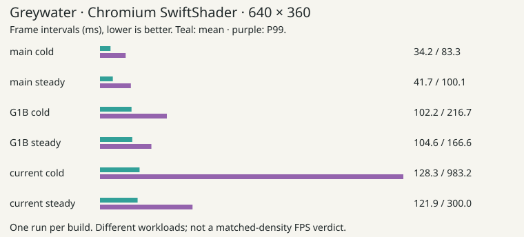

# Greywater — ba bản production, cùng cảnh, chưa cùng mật độ

Build Vite HTTP theo ba SHA, cùng lockfile, một browser process mới mỗi bản, Chromium 140.0.7339.0, SwiftShader ANGLE/Vulkan, 640×360 DPR1. Không chạy Vitest trong ba lượt đo; dùng Inspector để mở đúng POI, QA chỉ đọc mật độ/đồng hồ. Seed 20261109, `veyra05-at-1503-1068`, F0, player (1608,1608 px) và 23 creature giống nhau. Không xoá NPC/props, không cắt VFX, không dùng thời gian một frame làm FPS.

| Build | Người / entity | Mean steady | P50 | P95 | P99 | Heap cuối |
|---|---:|---:|---:|---:|---:|---:|
|main `82089fe`|0 / 9|41.7 ms|33.4|66.7|100.1|27 MiB|
|G1B `e93982f`|0 / 32|104.6 ms|100.0|133.4|166.6|56 MiB|
|current `cf58b0e`|286 / 41|121.9 ms|116.6|166.7|300.0|80 MiB|

Mỗi lượt: 60 khoảng rAF đầu và 180 sau; biểu đồ và JSON có cold + steady, toàn bộ intervals/long tasks, task/script seconds, heap, số actor đang làm/đi, đồng hồ trước/sau, thời gian từ load tới cảnh và native PNG. Số người là cả run, **không phải số sprite nhìn thấy**. Main/G1B mỗi lượt có 404 manifest PixelFX; current không có lỗi resource được ghi. Không có pageerror ở cả ba.

Mean steady hiện tại cao hơn khoảng 16.5% so G1B ở cảnh này; tail cũng chậm hơn. **Không có căn cứ đạt ngưỡng ≤10%.** Đây là một lượt/cảnh, mật độ actor/entity khác thật; không quy toàn bộ chênh lệch cho NPC và không đổi mật độ để làm kết quả đẹp. Không so CPU phần simulation thuần với frame/presentation. Cần thêm density-matched control, nhiều lượt, streaming/combat/crowd/save/evac và thiết bị thật. Không thay nghiệm thu của Creator.

Tái lập trên máy không có worker khác: `cd web && CHROME_BIN=/path/to/chromium bash scripts/npc-benchmark-builds.sh /tmp/soh-builds /tmp/soh-results`. Bản thứ ba là HEAD khi bắt đầu; xem SHA trong JSON, không suy nó là runtime T9 `eb04deb`.
