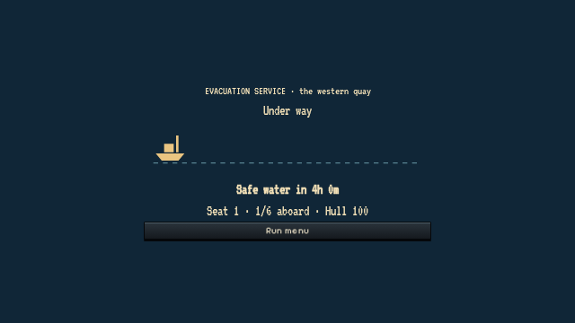

# Rời bến không để lại nhân vật trên đảo

Mã: `c0e7649` · Control tower 05 §D/R09 · **PARTIAL, kiểm tra có kiểm soát**.

Đặt ghế chưa phải rời đảo: khi tàu còn ở bến, nhân vật vẫn có thể bị thương hoặc rời hàng. Khi tàu khởi hành, log chốt hành lý, ngắt động tác kéo xe/đánh/lăn; chuyển động, nhặt đồ, tương tác, sát thương và phơi nhiễm tại tọa độ bến không còn áp dụng. Đồng hồ thế giới, chuyến tàu và hao mòn thân tàu vẫn chạy. Tàu hỏng ngoài khơi giữ nguyên ghế; không trả người về bờ. Cập bến an toàn mới ghi kết thúc `evacuated`, kể cả khi Continue sau thời điểm cập bến. Đây không phải mô hình sinh tồn hàng hải đầy đủ.

- **Ảnh 640×360**: save seed 7606 tạo bằng engine, đặt giờ mở dịch vụ và vị trí bến phía tây, đặt ghế, trả phí và gọi cast-off. Nạp snapshot qua Title → Continue trong Chromium mới, đóng báo cáo nếu có, thử I/F rồi mở/đóng menu. `browser.json` ghi ghế 1, 1/6 hành khách, hull 100, còn 4 giờ. Đồng hồ browser cố định, không phải 4 giờ chơi thực hoặc hành trình tự nhiên. Lặp lại: từ `web`, build và phục vụ `dist`, chạy `node scripts/npc-voyage-review.mjs <url> <thư-mục-kết-quả>`.
- **Kỹ thuật**: `tsc --noEmit -p tsconfig.test.json` và `npm run build` thành công. `regression.json`: 34/34 trong bốn suite `npc-evac-physical-service`, `npc-vessel-cost-and-hull`, `npc-dual-rescue-same-run`, `mec01-r5-offline-defense`. Bao gồm xung đột save/log, reload đang đi và mắc kẹt, sát thương/pickup tại bến, thời điểm kết thúc khi Continue.
- **Không xanh toàn bộ**: lượt chạy năm suite là **34/43**. Cả 9 ca `b03-return` dừng ở `setup → build` của trang trại, trước khi đánh giá báo cáo. Đối chiếu `tmp/verification/serial-eb04deb/{023.json,baseline/023.json}` cũng có 9 lỗi đó. Không sửa hoặc bỏ qua assertion để làm xanh.
- Chưa chứng minh ba bến trong chiến dịch tự nhiên, phòng thủ trước sáu Elder xuyên h336, hay Creator playtest. Các cổng nghề nghiệp, kinh tế liên khu và tuyển bạn đồng hành tự nhiên vẫn mở.
